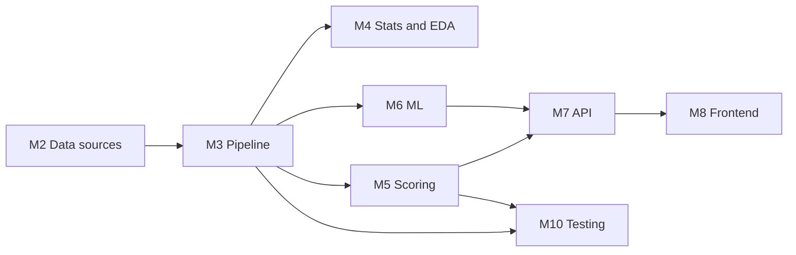
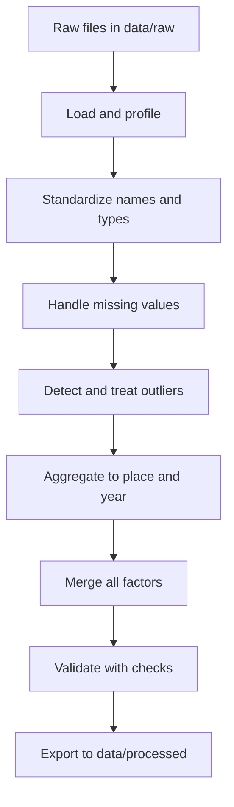
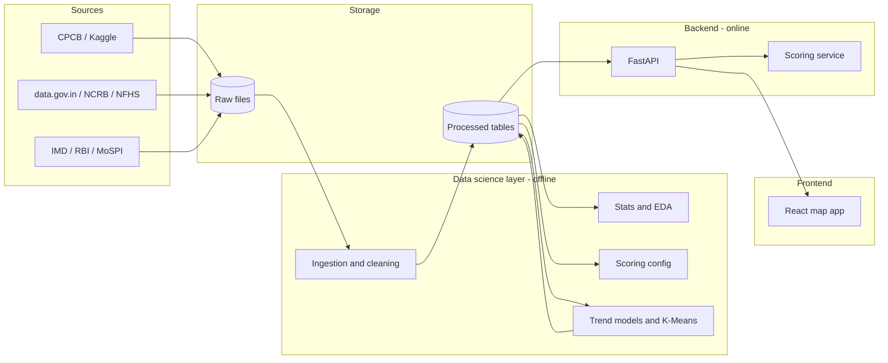

# India Livability Intelligence System
### Software Requirements Specification, Architecture and Data Science Pipeline

**Course:** Data Science using Python (CAPCTD3 Elective-V)
**Working title:** *Is India Becoming Less Livable? A Data-Driven Livability Index with Interactive Map and Trend Projection*
**Version:** 1.1 (revised after a dataset availability check, 26 October 2026)

> **Revision 1.1 summary.** A web check of the candidate datasets showed that only air quality is available at city level with a time series. Everything else is state-level, cost of living is a snapshot for six cities, and several series have gaps or breaks. This revision therefore: (1) cuts the core factors to air, safety, health and economy; (2) adds a verified dataset register and a list of unverified candidates (M2, Appendix D); (3) adds rules for gaps, series breaks and PDF extraction (M3.6); (4) separates trend-capable factors from snapshot factors (M5, M6); (5) replaces the validation split with one that fits the real years (M6.3); (6) updates the map boundary guidance, ethics, risks and timeline. Listings were found by web search; **no files have been downloaded or inspected yet.**

---

## How to use this document

This document is split into **independent modules**. Each module has its own purpose, inputs, outputs and a "present alone" note, so you can show any one of them separately in a viva, review or demo.

| ID | Module | Present it when someone asks about... |
|---|---|---|
| M0 | Project overview | "What is your project?" |
| M1 | Requirements (SRS) | "What does the system do?" |
| M2 | Data sources and dictionary | "Where does your data come from?" |
| M3 | Data engineering pipeline | "How did you clean and merge it?" |
| M4 | Statistics and EDA | "What did you find in the data?" |
| M5 | Livability scoring engine | "How is the score calculated?" |
| M6 | Machine learning (trend and clustering) | "Where is the model and prediction?" |
| M7 | Backend API | "How does the app get the data?" |
| M8 | Frontend and map interface | "Show me the app." |
| M9 | System architecture and deployment | "How is it built and hosted?" |
| M10 | Testing and validation | "How do you know it works?" |
| M11 | Ethics, privacy and limitations | "What are the risks?" (CO6) |
| M12 | Syllabus mapping | "How does this fit the course?" |
| M13 | Timeline and deliverables | "What is the plan?" |
| M14 | Viva preparation | "Defend your choices." |

**Dependency order** (a module only needs the ones before it on its arrow):



The notebook (M3 to M6) is the graded core. The API and frontend (M7 and M8) are the presentation layer. The system is designed so that M7 and M8 can be dropped without breaking M3 to M6.

---

# M0. Project Overview

## 0.1 Problem statement

People choosing where to live in India rely on anecdotes. Reliable information is scattered across many government datasets with different formats, naming conventions and geographic levels. There is no single, transparent, adjustable way to compare states and cities on what a person personally cares about, or to see whether a place is getting better or worse over time.

## 0.2 Objectives

1. Collect and integrate multiple public datasets (core: air quality, safety, health, economy; optional: a six-city cost-of-living snapshot) into one clean analytical dataset.
2. Define a **transparent, adjustable Livability Score** for states and major cities.
3. Statistically test whether livability differs across regions and what drives it.
4. Fit a **trend projection** for each place and flag those with a worsening outlook.
5. Present everything in an **interactive India map** where users set priorities and get a ranked, color-coded result.
6. Document limitations and ethical concerns honestly.

## 0.3 Scope

**In scope**
- 12 to 15 states. Cities are included **only if they have usable air quality data** (expected 10 to 25 after the coverage check in M2.1.3).
- **Four core factors:** air quality (city level), safety, health and economy (state level; economy combines income and unemployment).
- **One optional snapshot factor:** cost of living (rent) for six cities only, scored but never trended.
- Years differ by factor. Air quality is expected to cover 2015 to 2019 and 2023 to 2024 (with a gap); state factors cover roughly 7 to 14 yearly points. The real numbers are set by the coverage check.
- Linear regression trend projection and K-Means clustering.
- Web application with map, weight sliders, state ranking and city detail view.

**Out of scope**
- Real-time data feeds.
- City-level time series for any factor other than air quality.
- Factors whose data has not been verified (road safety, climate, water, education, see Appendix D).
- Neighbourhood or ward-level scoring.
- Deep learning models.
- User accounts and personal data storage.
- Claims of precise forecasts.

## 0.4 Key design principles

- **Transparency:** every score can be traced back to raw values and weights.
- **Honesty about uncertainty:** projections always carry intervals and warnings.
- **Modularity:** each stage reads files from the previous stage and writes files for the next.
- **Reproducibility:** one command re-runs the pipeline from raw data to final outputs.

---

# M1. Software Requirements Specification

## 1.1 Stakeholders and users

| User | Need |
|---|---|
| Person relocating or choosing a city | Find places matching personal priorities |
| Student or researcher | See the method, data and statistics |
| Examiner or reviewer | Verify syllabus coverage and correctness |
| Developer or maintainer | Rerun the pipeline and extend factors |

## 1.2 Functional requirements

### Data and pipeline
| ID | Requirement | Priority |
|---|---|---|
| FR-01 | The system shall ingest raw CSV/XLSX/JSON files from a defined raw data folder. | Must |
| FR-02 | The system shall standardize state and city names using a mapping table (e.g., Orissa to Odisha). | Must |
| FR-03 | The system shall handle missing values using documented rules and record which values were imputed. | Must |
| FR-04 | The system shall detect and treat outliers using a documented rule (IQR or z-score) and log removed rows. | Must |
| FR-05 | The system shall merge all factor datasets into one table keyed by place and year. | Must |
| FR-06 | The system shall export final datasets as versioned CSV or Parquet files. | Must |

### Scoring
| ID | Requirement | Priority |
|---|---|---|
| FR-07 | The system shall normalize every factor to a 0 to 100 scale, inverting factors where higher is worse. | Must |
| FR-08 | The system shall compute a weighted livability score from user-supplied weights that sum to 100%. | Must |
| FR-09 | The system shall rank places by score for any weight combination. | Must |
| FR-10 | The system shall return the per-factor breakdown behind each score. | Must |
| FR-11 | The system shall mark scores as low-confidence when a factor was imputed or inherited from the state level. | Should |

### Analysis and ML
| ID | Requirement | Priority |
|---|---|---|
| FR-12 | The system shall compute descriptive statistics (mean, median, mode, variance, SD, IQR, skewness, kurtosis) per factor. | Must |
| FR-13 | The system shall run hypothesis tests (t-test, ANOVA) on regional comparisons and report p-values with interpretation. | Must |
| FR-14 | The system shall fit a linear regression trend per place and produce a projection for the next 10 years with a prediction interval. | Must |
| FR-15 | The system shall cluster places with K-Means into livability tiers. | Should |
| FR-16 | The system shall report model evaluation metrics (MSE, RMSE, R-squared) on a held-out period. | Must |

### Application
| ID | Requirement | Priority |
|---|---|---|
| FR-17 | The app shall display an India map with state boundaries colored by score. | Must |
| FR-18 | The app shall display major cities as markers inside each state, colored by score. | Must |
| FR-19 | The app shall provide sliders for factor weights and update the map and ranking on change. | Must |
| FR-20 | The app shall let the user select a state and show a ranked list of its cities. | Must |
| FR-21 | The app shall let the user select a city and show factor breakdown plus a 10-year projected trend chart. | Must |
| FR-22 | The app shall provide a toggle to color the map by overall score or by a single factor. | Should |
| FR-23 | The app shall offer preset profiles (e.g., Clean Air, Family, Career, Retirement). | Could |
| FR-24 | The app shall allow comparing two to three places side by side. | Could |
| FR-25 | The app shall show a visible disclaimer next to every projection. | Must |
| FR-26 | The system shall exclude snapshot-only factors and series with too few points from trend projection and label them "no trend available". | Must |
| FR-27 | The system shall record series breaks (method or base-year changes) and gaps, and shall not fit a trend across a break without a flag. | Must |
| FR-28 | The app shall show, for every city, which factors are city-level and which are inherited from the state. | Should |

## 1.3 Non-functional requirements

| ID | Category | Requirement |
|---|---|---|
| NFR-01 | Performance | Map recolor after a slider change shall complete in under 1 second for all places in scope. |
| NFR-02 | Performance | Initial page load shall complete in under 5 seconds on a normal broadband connection. |
| NFR-03 | Usability | A first-time user shall be able to get a ranking in three interactions or fewer. |
| NFR-04 | Responsiveness | The interface shall be usable on screens from 360 px wide upward. |
| NFR-05 | Reliability | The app shall not crash on missing data; it shall show "data unavailable" instead. |
| NFR-06 | Reproducibility | Running the pipeline twice on the same raw data shall produce identical outputs. |
| NFR-07 | Maintainability | Adding a new factor shall require only a new loader file and one config entry. |
| NFR-08 | Transparency | The methodology page shall describe every formula and data source. |
| NFR-09 | Security | The API shall be read-only, validate all inputs and expose no secrets. |
| NFR-10 | Portability | The system shall run locally via Docker or a single start script. |
| NFR-11 | Accessibility | Colors shall be color-blind-safe and every color shall also have a numeric label. |
| NFR-12 | Licensing | Every dataset's license and attribution shall be recorded and displayed. |

## 1.4 Use cases

**UC-1: Find best place by priorities**
1. User opens the app.
2. User moves sliders (e.g., air quality 40%, safety 30%, cost 30%).
3. System recomputes scores and recolors the map.
4. User reads the top 10 list.

**UC-2: Explore a state**
1. User clicks a state.
2. System shows state score, factor breakdown and a ranked list of its cities.

**UC-3: Check a city's outlook**
1. User clicks a city.
2. System shows the factor breakdown, historical scores, and a projected 10-year trend with interval and disclaimer.

**UC-4: Compare places**
1. User selects up to three places.
2. System shows a radar or bar comparison of factor scores.

**UC-5: Read the method**
1. User opens the Methodology page.
2. System shows data sources, formulas, limitations.

## 1.5 Assumptions and constraints

- Only openly available datasets are used.
- Many factors exist only at the state level, so city scores combine city-level air quality with state-level factors (see M5).
- Yearly data points are few, so projections are naive trends.
- Only air quality has city-level data over time. Safety, health and economy are state-level. Cost of living is a six-city snapshot.
- Air data has a gap (the Kaggle series ends in 2020 and later CPCB tables are separate PDFs), and 2020 is a COVID-distorted year.
- Source periods differ (calendar year, financial year, July to June survey year) and must be aligned by a documented rule (M3.6).
- Team size is one; time budget is about 12 to 15 days for the core.

---

# M2. Data Sources and Data Dictionary

> **Present alone:** shows where every number comes from and how reliable it is.

## 2.1 Dataset register (listings verified by web search, 26 October 2026)

"Verified" means a listing was found. Files have **not** been downloaded or inspected. Confirm columns, years and licenses on the source page before relying on any row.

| Factor | Source | Level | Years (as listed) | Status | Notes and risks |
|---|---|---|---|---|---|
| Air quality (history) | Kaggle "Air Quality Data in India (2015 - 2020)": `city_day.csv`, `station_day.csv`, `stations.csv` | City, daily | 2015 to 2020 | Usable | License not shown on one mirror; check the Kaggle page. 2020 is a COVID year. |
| Air quality (recent) | CPCB NAMP annual tables, for example "Ambient Air Quality Status of the Country during 2023"; NCAP annual city tables | City, annual | 2023 and 2024 listed; 2021 and 2022 not confirmed | Usable with effort | Published as PDFs. PM2.5 is blank for some cities. Different method from the Kaggle daily data. |
| Safety | NCRB Crime in India (state-wise and metro-city tables) via data.gov.in or Dataful | State; metro cities only | Up to 2024 | Usable, check access | IPC to BNS transition may break the series in 2024. One metro dataset notes a missing year (2021). Crime rates reflect reporting as well as crime. |
| Health | SRS Statistical Report (state infant mortality) | State | Latest report covers 2022, published June 2025 | Usable | About three years of lag. Survey-based estimates. |
| Economy: income | RBI Handbook of Statistics on Indian States, per capita NSDP at constant prices | State | Long series to 2024-25 | Good | Use the 2011-12 base series only (earlier years are factor cost). Financial years. |
| Economy: unemployment | MoSPI PLFS annual reports (state and UT annexure) | State | 2017-18 to 2023-24, plus a calendar-year 2024 release | About 7 points | Tables inside PDFs. July to June survey years. |
| Cost of living (snapshot) | Kaggle "House Rent Prediction Dataset" (about 4,700 listings) | 6 cities: Kolkata, Mumbai, Bangalore, Delhi, Chennai, Hyderabad | One snapshot | Optional, never trended | Reported license CC BY-SA 4.0 (attribution and share-alike apply). |
| Cost of living (price index) | MoSPI state CPI (base 2012=100, new 2024=100 base) | State | Monthly from 2013 | **Not used** | It measures price change, not cost level between places, and the base year change is a series break. |
| Boundaries | Survey of India external boundary via DataMeet; state-boundary GeoJSON from open repositories | Geometry | n/a | Verify before use | License of the official layer is unclear. One open state layer is reported to label Telangana as Andhra Pradesh and to use pre-delimitation boundaries. Another reflects 2019 boundaries. |

**Unverified candidates (do not use until checked):** road deaths (MoRTH), climate (IMD temperature and rainfall), groundwater (RBI Handbook has a state-wise groundwater extraction table; confirm whether it is a series or one year), education and literacy (UDISE+, Census), NFHS indicators, and city coordinates and population. See Appendix D.

## 2.1.1 Factor eligibility rules

| Class | Rule | Treatment |
|---|---|---|
| **Trend-capable** | At least 5 yearly points for the place, with no unflagged series break | Scored and projected |
| **Snapshot** | One year only, or fewer than 5 points | Scored for the latest year, never projected, labelled "no trend available" |
| **Excluded** | Not verified, not comparable across places, or license unclear | Not in the project |

## 2.1.2 City inclusion rule (default, tune after the coverage check)

A city is included only if its air quality has at least 4 valid years in 2015 to 2019 and at least 1 valid year in 2023 to 2024. A valid Kaggle year has at least 75% of days present; a valid CPCB year has a non-blank PM2.5 annual average. All other factors for that city are inherited from its state.

## 2.1.3 First task: the coverage check

Before any design work continues, download the Kaggle air files and the CPCB annual PDF(s) and produce one table: city, years available per source, valid-year count, passes or fails the inclusion rule. The result sets the final city list, and therefore the whole project scope.

## 2.2 Place master table

One table defines every place the system knows about.

| Column | Type | Description |
|---|---|---|
| `place_id` | string | Unique key, e.g., `IN-MH-PUN` |
| `place_name` | string | Display name |
| `place_type` | enum | `state` or `city` |
| `state_name` | string | Standardized state name |
| `latitude`, `longitude` | float | Marker location |
| `region` | enum | North, South, East, West, Central, Northeast |

A separate **name mapping table** (`name_aliases.csv`) maps every variant spelling found in raw data to the standard name.

## 2.3 Tidy analytical dataset schema

After M3, all factors live in one long table, `factors_tidy`.

| Column | Type | Description |
|---|---|---|
| `place_id` | string | Foreign key to place master |
| `year` | int | Calendar or fiscal year (documented per factor) |
| `factor` | string | e.g., `pm25`, `crime_rate` |
| `value_raw` | float | Cleaned raw value |
| `value_norm` | float | 0 to 100 normalized score |
| `is_imputed` | bool | True if value was filled |
| `is_inherited` | bool | True if a city uses its state's value |
| `series_break` | bool | True if a method or base-year change affects this value |
| `gap_flag` | string | Notes such as `covid_year` or `after_gap` |
| `source_id` | string | Link to the source register |

## 2.4 Source register

| Column | Description |
|---|---|
| `source_id` | Short key |
| `name` | Dataset name |
| `publisher` | Organization |
| `url` | Where it was downloaded |
| `license` | License or terms |
| `downloaded_on` | Date |
| `level` | State, city, district |
| `notes` | Known quality issues |

---

# M3. Data Engineering Pipeline

> **Present alone:** a full demonstration of Unit I and Unit II skills (Pandas, cleaning, encoding, outliers).

## 3.1 Pipeline stages



## 3.2 Stage details

| Stage | What happens | Pandas tools |
|---|---|---|
| Load and profile | Read each file, record shape, dtypes, null counts, min and max | `read_csv`, `.info()`, `.describe()`, `.isnull().sum()` |
| Standardize | Strip whitespace, fix case, map state and city aliases, parse dates, fix numeric strings | `.str.strip()`, `.map()`, `to_datetime`, `to_numeric(errors="coerce")` |
| Missing values | Rule per column (see 3.3), flag every imputed value | `.dropna()`, `.fillna()`, `.interpolate()` |
| Outliers | IQR rule or z-score, plus domain bounds (e.g., PM2.5 cannot be negative) | `.quantile()`, boolean masks |
| Aggregate | Daily air data to yearly mean per city; city data to a state value where needed | `.groupby()`, `.agg()` |
| Merge | Left-join onto the place master by `place_id` and `year` | `.merge()`, `.pivot_table()` |
| Validate | Assertions on ranges, duplicates, coverage | `assert`, custom checks |
| Export | Write processed files with a version tag | `.to_csv()`, `.to_parquet()` |

## 3.3 Missing data policy

| Situation | Rule | Flag |
|---|---|---|
| Fewer than 20% of values missing in a numeric column | Fill by interpolation within the place over time, else median | `is_imputed = True` |
| More than 20% missing for a place and factor | Do not impute; mark factor unavailable for that place | Excluded from score |
| Categorical missing | Mode, or "Unknown" if mode is misleading | Flagged |
| Air data with less than 75% of days in a year | Drop that city-year | Logged |

## 3.4 Outlier policy

1. Apply **domain bounds** first (physically impossible values are errors).
2. Apply the **IQR rule** (outside Q1 minus 1.5 IQR or Q3 plus 1.5 IQR) to flag candidates.
3. **Review flagged values:** keep real extremes (e.g., genuinely hazardous Delhi winter air), remove sensor errors.
4. Log every removal in `outlier_log.csv` with reason.

Do not blindly delete extremes. Severe pollution is the point of the project, not noise.

## 3.5 Encoding

- **Label encoding** for ordered categories (e.g., AQI category Good < Satisfactory < Moderate < Poor < Very Poor < Severe).
- **One-hot encoding** for unordered categories such as `region` when used as a regression feature.

## 3.6 Series breaks, gaps and PDF extraction

| Issue | Where | Handling |
|---|---|---|
| Air gap | Kaggle ends in 2020; recent CPCB tables are separate; 2021 and 2022 not confirmed | Treat year as a real number (not a row index), fit on available years only, set `gap_flag` |
| COVID year | 2020 air data | Keep, flag `covid_year`, and run trends with and without it as a sensitivity check |
| Two air methods | Kaggle daily station data vs CPCB annual city averages | Record `air_source`. If any overlapping year exists, compare to estimate an offset; if not, flag the join as a series break |
| Blank PM2.5 | CPCB annual tables | Leave missing. Do not silently substitute PM10; if PM10 is used, keep it as a separate indicator |
| Crime series break | NCRB, IPC to BNS in 2024 | Set `series_break` for affected years; compare broad totals before trending |
| Missing metro years | NCRB metro-city tables | Treat as missing, not zero |
| Base year | RBI NSDP | Use only the 2011-12 base series |
| Different calendars | PLFS (July to June), NSDP (financial year), NCRB and SRS (calendar year) | Align to a reference year by one documented rule (for example, financial year 2022-23 becomes 2022) and store `period_type` |
| Cost-of-living CPI | MoSPI CPI | Not used (price change, not level; base-year break) |
| PDF tables | CPCB, PLFS, SRS | Extract with `pdfplumber`, `camelot` or `tabula`, keep the raw PDF, log the method, and hand-check at least 10% of rows against the PDF |

## 3.7 Outputs of M3

| File | Content |
|---|---|
| `data/processed/places.csv` | Place master |
| `data/processed/factors_tidy.parquet` | Cleaned long table |
| `data/processed/factors_wide.csv` | One row per place and year, one column per factor |
| `reports/data_quality_report.md` | Coverage, imputation counts, outlier counts |
| `reports/outlier_log.csv` | Every removed value |

## 3.8 Folder structure for the pipeline

```
data/
  raw/                # untouched downloads + source_register.csv
  interim/            # partially cleaned files
  processed/          # final analytical tables
src/
  loaders/            # one loader per source
  cleaning/           # names, missing, outliers
  features/           # normalization, derived features
  scoring/
  models/
  utils/
notebooks/
  01_data_profiling.ipynb
  02_cleaning_merging.ipynb
  03_statistics_eda.ipynb
  04_scoring.ipynb
  05_ml_trend_clustering.ipynb
reports/
tests/
```

---

# M4. Statistics and Exploratory Data Analysis

> **Present alone:** covers Units II, III and IV directly.

## 4.1 Descriptive statistics (Unit III)

For each factor, report:

| Measure | Purpose |
|---|---|
| Mean, median, mode | Central tendency |
| Variance, standard deviation, range, IQR | Spread |
| Skewness, kurtosis | Shape (pollution is usually right-skewed) |
| Covariance and correlation matrix | Relationships between factors |

Show a log transform where skew is strong and discuss whether it helps.

## 4.2 Probability and distributions

- Test whether key factors (e.g., yearly mean PM2.5) look normal using a histogram with a fitted curve, a Q-Q plot and a Shapiro-Wilk test.
- Compute empirical probabilities such as P(city AQI category is Poor or worse in a year).
- Show a **conditional probability** example, such as P(Poor air | northern region).

## 4.3 Inferential statistics

| Technique | Application in this project |
|---|---|
| Sampling | Draw random samples of city-years and compare their means with the full data |
| Central Limit Theorem | Repeatedly sample city-year PM2.5 values and plot the distribution of sample means |
| Confidence interval | 95% CI for mean PM2.5 and for mean livability score |

## 4.4 Hypothesis tests

State H0 and H1 before running each test, and interpret the p-value in plain words.

| # | Question | Test | H0 |
|---|---|---|---|
| H1 | Is mean PM2.5 different between northern and southern cities? | Two-sample t-test (Welch) | Means are equal |
| H2 | Does livability score differ across regions? | One-way ANOVA (post hoc Tukey if significant) | All region means are equal |
| H3 | Is the mean PM2.5 of selected cities above the national standard value? | One-sample t-test | Mean equals the standard |
| H4 | Did city PM2.5 differ between 2019 and 2024? | Paired t-test (or Wilcoxon signed-rank if not normal) | Mean difference is zero |
| H5 | Is state per capita income related to city PM2.5? | Spearman correlation test | Correlation is zero |

Discuss **Type I and Type II errors** for at least one test, and check assumptions (normality, equal variance) before trusting results. If assumptions fail, note the non-parametric alternative (Mann-Whitney, Kruskal-Wallis).

## 4.5 EDA (Units III and IV)

**Univariate:** histogram, box plot and KDE per factor.
**Bivariate:** scatter plots (e.g., PM2.5 vs health outcomes), box plots by region.
**Multivariate:** correlation heatmap, pair plot, FacetGrid by region.
**Time:** line charts of yearly factor values per city, small multiples for comparison.
**Profiling:** coverage heatmap showing which place-year-factor cells have data.

## 4.6 Matplotlib and Seaborn checklist

| Plot | Library | Used for |
|---|---|---|
| Line | Matplotlib | Trends over years |
| Scatter | Matplotlib | Factor relationships |
| Bar | Matplotlib | Rankings |
| Histogram | Matplotlib or Seaborn | Distributions |
| Box plot | Both | Regional comparisons, outliers |
| Subplots | Matplotlib | Dashboard-style summary |
| Heatmap | Seaborn | Correlations, coverage |
| Pair plot | Seaborn | Multivariate view |
| FacetGrid | Seaborn | Per-region trends |

## 4.7 Output

`notebooks/03_statistics_eda.ipynb`, a figures folder and `reports/findings.md` with a short list of interpreted results.

---

# M5. Livability Scoring Engine

> **Present alone:** the core "intelligence" of the project, and a self-contained function you can demo in a notebook.

## 5.1 Factor definitions

Each factor has a configuration entry. Core factors are always available; optional factors only apply where the data exists.

```yaml
factors:
  air_quality:
    column: pm25_mean
    direction: lower_is_better
    level: city
    trend: eligible              # needs >= 5 valid years
    bounds: [10, 150]            # placeholder, set from data (see note)
  safety:
    column: crime_rate_per_lakh
    direction: lower_is_better
    level: state                 # metro-city NCRB rates are not comparable with state rates
    trend: eligible_with_break_flag
    bounds: [100, 600]           # placeholder
  health:
    column: infant_mortality
    direction: lower_is_better
    level: state
    trend: eligible
    bounds: [5, 50]              # placeholder
  economy:
    level: state
    trend: eligible
    indicators:                  # averaged inside the factor
      - column: per_capita_nsdp_constant
        direction: higher_is_better
      - column: unemployment_rate
        direction: lower_is_better
  cost_of_living:               # OPTIONAL
    column: avg_rent
    direction: lower_is_better
    level: city                  # six cities only
    trend: never                 # one snapshot
```

Bounds shown are placeholders. Set them from the real data (for example the 5th and 95th percentiles across all years) and from published reference values, and document the choice. If a factor has several indicators, normalize each one first and average them inside the factor.

## 5.2 Normalization

For a factor value `x` with bounds `[lo, hi]`, clipped to that range:

- Higher is better: `score = 100 × (x − lo) / (hi − lo)`
- Lower is better: `score = 100 × (hi − x) / (hi − lo)`

Using **fixed bounds rather than min and max of the current data** keeps scores comparable across years. This is important for trend projection, since otherwise improving one city changes everyone else's score.

## 5.3 Weighted livability score

For place `p` in year `t`, with user weights `w_i` summing to 1:

```
Score(p, t) = Σ ( w_i × score_i(p, t) )
```

If a factor is unavailable for a place, **re-normalize the remaining weights** so they still sum to 1, and flag the place as `partial_data = true` with the list of missing factors.

## 5.4 City versus state score

- A city's **air quality** comes from city-level data.
- Its **safety, health and economy** values are inherited from its state and flagged `is_inherited = true`.
- Metro-city NCRB figures are not mixed into the state series, because city and state rates are not directly comparable. They may be shown as an extra detail for the metro cities that have them.
- **Cost of living** is available only for the six snapshot cities. In the app it appears as an optional toggle that adds a rent factor for those cities and is hidden elsewhere.
- The app shows a small "state-level data" label next to every inherited factor.

**Consequence to state openly:** two cities in the same state differ only in their air quality (and rent, where available). The score ranks air quality within a state; state-level factors mostly separate states.

## 5.5 Default weights and presets

Weights apply to the four core factors and sum to 100.

| Profile | Air | Safety | Health | Economy |
|---|---|---|---|---|
| Balanced | 30 | 25 | 25 | 20 |
| Clean air first | 55 | 15 | 20 | 10 |
| Family | 20 | 30 | 30 | 20 |
| Career | 15 | 15 | 10 | 60 |
| Retirement | 30 | 15 | 45 | 10 |

These weights are subjective. State this openly and let the user change them. Extra factors (cost of living, or any later verified factor) are added only through the optional toggle and re-normalize the weights.

## 5.6 Sensitivity analysis

Because weights are subjective, test how stable the ranking is:

1. Randomly perturb the weights many times (for example 1,000 draws from a Dirichlet distribution centered on the default).
2. Record each place's rank in every draw.
3. Report the median rank and the rank range, and mark places whose rank barely changes as **robust**.

This single analysis turns a debatable score into a defensible one.

## 5.7 Function contract

```python
def compute_scores(
    factors_wide: pd.DataFrame,      # place_id, year, factor columns
    config: dict,                    # factor definitions and bounds
    weights: dict[str, float],       # factor -> weight, sums to 1
    year: int | None = None          # None means latest year
) -> pd.DataFrame:
    """Returns place_id, score, rank, per-factor scores, partial_data flag."""
```

Pure function, no file or network access, so it is easy to test (M10).

---

# M6. Machine Learning Module

> **Present alone:** satisfies Unit V and CO5.

## 6.1 Trend projection with linear regression

**Goal:** estimate the direction a place is heading, and flag worsening places.

**Method**
1. For each place, take the yearly livability score (or each individual factor).
2. Fit a simple linear regression: `score = a + b × year`.
3. Use `b` (the slope, in points per year) as the **trend indicator**.
4. Project 10 years ahead with a **95% prediction interval**.
5. Clip projections to the valid 0 to 100 range.

**Classification of outlook** (thresholds are examples, set them from the observed slope distribution):

| Condition | Label |
|---|---|
| Slope significantly below zero (p < 0.05) | Declining |
| Slope not significantly different from zero | Stable or uncertain |
| Slope significantly above zero | Improving |

Using statsmodels OLS gives slope p-values and prediction intervals directly. With only 5 to 10 points, intervals will be wide, and that is the honest result.

### 6.1.1 Trend eligibility

| Factor | Typical points | Trend allowed? | Note |
|---|---|---|---|
| Air quality | About 5 (2015 to 2019) plus 2 (2023 to 2024), with a gap | Yes, with the gap and COVID flags | Fit on actual years; show a wide interval across the gap |
| Safety | Up to the 2024 release | Only with a series-break flag | A break in 2024 may invalidate a straight line |
| Health | Several years to 2022 | Yes | Data ends earlier than other factors |
| Economy | Long NSDP series; about 7 PLFS points | Yes, limited by the PLFS overlap | The factor trend uses only years where both indicators exist |
| Cost of living | One snapshot | **No** | Show "no trend available" |

If a place has fewer than 5 valid points for a factor, or fewer than 5 for the overall score, the outlook label is **Insufficient data** and no projection is drawn. The overall-score trend is computed only from years in which all core factors exist for that place, so it may be short.

## 6.2 Multiple linear regression (drivers)

**Goal:** identify which factors explain differences in livability or in a health outcome.

- Target: e.g., health score, or overall score.
- Features: air, safety, economy, region (one-hot encoded).
- Report coefficients, standard errors, R-squared and adjusted R-squared.
- Check **assumptions:** linearity (residual vs fitted), normality of residuals (Q-Q plot), homoscedasticity, multicollinearity (VIF).

**Caution:** if the target is computed from the same features, the regression is circular. Choose a target that is **independent** of the predictors (such as a health outcome predicted from air and economy factors).

## 6.3 Validation (Unit V: train, validate, test)

Because the data is time-ordered and has gaps, use a **time-based split**, never a random one. The exact years depend on the coverage check; the plan below shows the intent.

| Series | Train | Validation | Test |
|---|---|---|---|
| Air quality | 2015 to 2018 | 2019 | 2023 to 2024 (a hard extrapolation across the gap, which is an honest test) |
| State factors with 7 to 10 points | First n minus 3 points | Next point | Last 2 points |

Report **MSE, RMSE and R-squared** on validation and test, and compare against a **naive baseline** (last observed value repeated). With so few points, report results per factor and do not over-interpret R-squared. If the regression cannot beat the baseline, say so; that is a valid finding.

## 6.4 K-Means clustering (unsupervised)

- **Input:** standardized factor scores per place for the latest year.
- **Choose k:** elbow method plus silhouette score, expected k of 3 or 4.
- **Output:** cluster labels, interpreted by cluster mean profile (for example "clean and affluent", "polluted but high income", "low cost but weak services").
- **Use in app:** an optional "tier" color mode.

## 6.5 Optional extras (only after the core is done)

- Ridge regression for comparison with ordinary least squares.
- A simple ARIMA or Holt-Winters forecast, compared against the linear trend.
- Rank correlation between your score and any published livability ranking, as an external sanity check.

## 6.6 Model outputs

| File | Content |
|---|---|
| `data/processed/trends.csv` | place_id, factor, slope, p_value, r2, projection years 1 to 10 with lower and upper bounds, outlook label |
| `data/processed/clusters.csv` | place_id, cluster_id, tier_label |
| `models/metrics.json` | MSE, RMSE, R2 per model and split |

---

# M7. Backend API

> **Present alone:** shows software engineering skills with an API-first design. Test it with the auto-generated docs page, no frontend needed.

## 7.1 Responsibilities

- Serve the precomputed data and the scoring function.
- Recompute scores on demand when weights change (cheap, since it is a weighted sum).
- Never retrain models at request time.

## 7.2 Technology

| Concern | Choice | Reason |
|---|---|---|
| Framework | FastAPI | Typed, fast, automatic docs |
| Validation | Pydantic | Input checks |
| Data access | Pandas loaded once at startup, or SQLite/PostgreSQL | Small data, so in-memory is enough |
| Server | Uvicorn | Standard for FastAPI |

## 7.3 Endpoints

| Method | Path | Description |
|---|---|---|
| GET | `/api/health` | Service status and data version |
| GET | `/api/places` | List all places with type, state, coordinates |
| GET | `/api/factors` | List factors with direction, level, source and whether a trend is allowed |
| POST | `/api/score` | Body: weights and optional year. Returns scores and ranks for all places |
| GET | `/api/states/{state_id}/ranking` | City ranking inside a state for given weights (query params) |
| GET | `/api/places/{place_id}` | Details: factors, inherited flags, history |
| GET | `/api/places/{place_id}/trend` | Historical values and 10-year projection with intervals |
| GET | `/api/clusters` | Tier labels |
| GET | `/api/stats/summary` | Key statistical findings for the methodology page |
| GET | `/api/sources` | Source register |

### Example: `POST /api/score`

Request:
```json
{
  "weights": {
    "air_quality": 0.4,
    "safety": 0.3,
    "cost_of_living": 0.3
  },
  "year": 2024,
  "place_type": "city"
}
```

Response (shortened):
```json
{
  "year": 2024,
  "weights_normalized": {"air_quality": 0.4, "safety": 0.3, "cost_of_living": 0.3},
  "results": [
    {
      "place_id": "IN-XX-AAA",
      "name": "Example City",
      "score": 72.4,
      "rank": 1,
      "factor_scores": {"air_quality": 80.1, "safety": 65.0, "cost_of_living": 68.3},
      "partial_data": false,
      "inherited_factors": ["safety"]
    }
  ]
}
```

## 7.4 Validation and error handling

| Case | Response |
|---|---|
| Weights missing or all zero | 422 with a clear message |
| Weights do not sum to 1 | Normalize automatically and return the normalized weights |
| Unknown factor or place | 404 |
| Data file missing at startup | Fail fast with a readable log message |

## 7.5 Security and operations

- Read-only API, no write endpoints.
- CORS limited to the frontend origin.
- Basic rate limiting if publicly hosted.
- No secrets in the repo; configuration through environment variables.
- Structured logs for requests and errors.

## 7.6 Backend folder structure

```
backend/
  app/
    main.py
    api/routes_places.py
    api/routes_score.py
    api/routes_trends.py
    core/config.py
    core/loader.py        # loads processed data once
    services/scoring.py   # imports the M5 function
    schemas/              # Pydantic models
  tests/
  Dockerfile
  requirements.txt
```

---

# M8. Frontend and Map Interface

> **Present alone:** the visual demo. Can run against the API or against static JSON files.

## 8.1 Technology options

| Option | Stack | When to choose |
|---|---|---|
| **A: Fast path** | Streamlit + Plotly | If time is short. A single Python file, enough for the exam. |
| **B: Full stack** | React + Vite + MapLibre GL or Leaflet + Recharts or Plotly | Stronger portfolio piece. Do this after the notebook is complete. |

The rest of this module describes option B. Option A uses the same screens and logic.

## 8.2 Screens

### Screen 1: Map explorer (main)
- India map with state polygons colored by score.
- City markers (circles) colored by score, sized by population optionally.
- **Left panel:** weight sliders per factor, preset dropdown, year selector.
- **Right panel:** top 10 list, updates live.
- **Toggle:** overall score, single factor, or tier (cluster) color mode.
- **Legend** with numeric ranges.

### Screen 2: State view
- Opens when a state is clicked.
- Zooms to the state, shows its cities ranked.
- State factor breakdown as a horizontal bar chart.

### Screen 3: City detail
- Header: city name, score, rank, outlook label (Improving, Stable or uncertain, Declining).
- Factor breakdown (radar or bar), with "state-level data" tags on inherited factors.
- Historical score line plus 10-year projection with shaded interval.
- **Disclaimer box:** "Naive trend projection from limited yearly data. Not a prediction of future conditions."

### Screen 4: Compare
- Choose 2 to 3 places and see grouped bars and a radar chart.

### Screen 5: Insights
- Key statistical findings from M4 (plots and interpretations).
- Hypothesis test results in plain language.

### Screen 6: Methodology
- Data sources and licenses, normalization formulas, weights, limitations, ethics notes.

## 8.3 Wireframe (main screen)

```
+----------------------------------------------------------------------+
|  India Livability Explorer          [Preset v]  [Year v]   [Methodology]|
+---------------------+------------------------------------+-----------+
| WEIGHTS             |                                    | TOP 10    |
| Air quality   [===] |                                    | 1. City A |
| Health        [==]  |            INDIA MAP               | 2. City B |
| Safety        [===] |      (states + city markers)       | 3. City C |
| Economy       [=]   |                                    | ...       |
| Cost (6 cities)[=]  |                                    |           |
| (optional toggle)   |                                    | [Compare] |
| [Reset]             |                                    |           |
| Color by: (o)Overall|     Legend: low ---- high           |           |
|           ( )Factor |                                    |           |
|           ( )Tier   |                                    |           |
+---------------------+------------------------------------+-----------+
```

## 8.4 Interaction behavior

| Action | Result |
|---|---|
| Move a slider | Debounced (about 150 ms) call to `/api/score`, then recolor |
| Click a state | Zoom, show state view |
| Click a city marker | Open city detail drawer |
| Hover | Tooltip with name, score and rank |
| Select preset | Sliders jump to preset weights |
| Click compare | Add place to comparison tray (max 3) |

**Performance tip:** since the scoring is a weighted sum over a small table, you can ship the normalized factor table to the browser and compute scores client-side for instant slider response. The API then serves only as a source of truth and for the trend data.

## 8.5 Map data requirements

- Use boundaries whose source and license you have checked. The Survey of India external boundary is available through DataMeet, but its license is described as unclear; some open state layers reportedly label Telangana as part of Andhra Pradesh, use pre-delimitation boundaries, or reflect 2019 boundaries.
- **Before building the UI:** load the chosen layer and visually check Telangana, Jammu and Kashmir, Ladakh, and the Dadra and Nagar Haveli and Daman and Diu merger. Make sure the external border matches the official Survey of India depiction; incorrect borders can cause real problems in a submission or deployment.
- Simplify the geometry to keep the file small (a few hundred KB).
- Match GeoJSON state names to your standardized names through the same alias table used in M3.
- Record the boundary source, license and check date in the source register.

## 8.6 UI and accessibility

- Color scale: a color-blind-safe sequential palette, not plain red and green.
- Show the numeric score in tooltips and the list, not color alone.
- Keyboard-accessible controls and sufficient contrast.
- Mobile layout: panels become bottom sheets.

## 8.7 Frontend folder structure

```
frontend/
  src/
    components/
      MapView.jsx
      WeightPanel.jsx
      RankingList.jsx
      CityDetail.jsx
      TrendChart.jsx
      CompareView.jsx
    pages/
      Explorer.jsx
      Insights.jsx
      Methodology.jsx
    services/api.js
    hooks/useScores.js
    utils/colorScale.js
  public/
    india_states.geojson
  package.json
```

---

# M9. System Architecture and Deployment

> **Present alone:** a systems-level overview for any "how does it all fit together" question.

## 9.1 Logical architecture



**Key idea:** the heavy data science runs **offline** and writes files. The online app only reads those files, which makes it fast, cheap to host and easy to explain.

## 9.2 Layered view

| Layer | Contents | Technology |
|---|---|---|
| Presentation | Map, sliders, charts | React, MapLibre or Leaflet, Recharts or Plotly |
| API | REST endpoints, validation | FastAPI, Pydantic |
| Domain logic | Scoring, ranking, trend lookup | Python module shared with the notebook |
| Data | Processed tables, source register | Parquet or CSV, optionally SQLite or PostgreSQL |
| Offline analytics | Cleaning, statistics, ML | Pandas, NumPy, SciPy, statsmodels, scikit-learn, Matplotlib, Seaborn |
| Infrastructure | Containers, CI, hosting | Docker, GitHub Actions, Render or similar, Vercel or Netlify |

## 9.3 Technology stack summary

| Area | Tools |
|---|---|
| Language | Python 3.11+, JavaScript (or TypeScript) |
| Data | Pandas, NumPy |
| Statistics | SciPy, statsmodels |
| ML | scikit-learn |
| Visualization (offline) | Matplotlib, Seaborn |
| Notebook | Jupyter or Google Colab |
| Backend | FastAPI, Uvicorn, Pydantic |
| Frontend | React, Vite, MapLibre GL or Leaflet, Recharts or Plotly |
| Storage | Parquet or CSV, optionally SQLite or PostgreSQL |
| Testing | pytest, Vitest or Jest |
| DevOps | Docker, Docker Compose, GitHub Actions |
| Version control | Git, GitHub |

## 9.4 Data storage choice

For this data size (a few thousand rows), files are enough. A database is optional.

| Choice | Pros | Cons |
|---|---|---|
| CSV or Parquet loaded at startup | Simplest, no infrastructure, easy to version | No concurrent writes (not needed, read-only) |
| SQLite | Single file, SQL practice | Extra loading step |
| PostgreSQL | Realistic production setup, good for portfolio | More setup, overkill for this size |

**Recommendation:** files first. Add PostgreSQL later only if you want to show database skills.

## 9.5 Optional database schema (if you use SQL)

```sql
CREATE TABLE places (
  place_id TEXT PRIMARY KEY,
  place_name TEXT NOT NULL,
  place_type TEXT CHECK (place_type IN ('state','city')),
  state_name TEXT NOT NULL,
  latitude REAL, longitude REAL,
  region TEXT
);

CREATE TABLE factor_values (
  place_id TEXT REFERENCES places(place_id),
  year INTEGER,
  factor TEXT,
  value_raw REAL,
  value_norm REAL,
  is_imputed BOOLEAN DEFAULT FALSE,
  is_inherited BOOLEAN DEFAULT FALSE,
  series_break BOOLEAN DEFAULT FALSE,
  source_id TEXT,
  PRIMARY KEY (place_id, year, factor)
);

CREATE TABLE trends (
  place_id TEXT REFERENCES places(place_id),
  factor TEXT,            -- 'overall' for the combined score
  slope REAL, p_value REAL, r2 REAL,
  outlook TEXT,
  PRIMARY KEY (place_id, factor)
);

CREATE TABLE projections (
  place_id TEXT, factor TEXT, year INTEGER,
  yhat REAL, lower REAL, upper REAL,
  PRIMARY KEY (place_id, factor, year)
);

CREATE TABLE clusters (
  place_id TEXT PRIMARY KEY REFERENCES places(place_id),
  cluster_id INTEGER, tier_label TEXT
);

CREATE TABLE sources (
  source_id TEXT PRIMARY KEY,
  name TEXT, publisher TEXT, url TEXT,
  license TEXT, downloaded_on DATE, level TEXT, notes TEXT
);
```

## 9.6 Deployment

| Component | Option | Notes |
|---|---|---|
| Notebooks | Google Colab or local Jupyter | Add an "Open in Colab" badge |
| Backend | Render, Railway or a small VM, run through Docker | Free tiers may sleep when idle |
| Frontend | Vercel or Netlify | Static build |
| Quick demo path | Streamlit Community Cloud | One file, minimal setup |

**Docker Compose layout**
```
services:
  backend:  FastAPI, port 8000, mounts data/processed read-only
  frontend: built static files served by Nginx, port 3000
```

## 9.7 CI and automation

- GitHub Actions on every push: lint, run unit tests, run the pipeline on a small sample dataset, build the frontend.
- A `Makefile` or script with the commands: `make data`, `make notebooks`, `make api`, `make web`, `make test`.

## 9.8 Scalability note (supports the "big data and cloud" course objective)

The current design is small by choice. If data grew to many millions of rows (for example hourly readings from every station), the migration path is:

| Today | At larger scale |
|---|---|
| Pandas | Dask or Spark |
| Parquet files | Partitioned Parquet in cloud object storage |
| Notebook run | Scheduled pipeline (Airflow or a cloud scheduler) |
| In-memory API data | Database plus caching |

Mention this in the report as a design consideration; do not build it.

---

# M10. Testing and Validation

> **Present alone:** shows engineering discipline and answers "how do you know the numbers are right?"

## 10.1 Data tests

| Test | Check |
|---|---|
| Schema | Required columns and data types present |
| Range | No negative pollutant values, scores within 0 to 100 |
| Uniqueness | No duplicate (place, year, factor) rows |
| Coverage | Each selected place has the minimum required factors |
| Referential | Every `place_id` exists in the place master |
| Name mapping | No unmapped state or city names after cleaning |
| Series breaks | Every known break (IPC to BNS, base-year change, air source change) carries `series_break` |
| Trend eligibility | No projection exists for a place with fewer than 5 valid points or for a snapshot factor |

## 10.2 Unit tests for scoring

| Test | Expected |
|---|---|
| Normalization at lower bound, upper bound and beyond | 0 or 100 as appropriate, clipped |
| Direction inversion | Lower pollution gives a higher score |
| Weights sum to 1 | Normalization of arbitrary weights works |
| Missing factor | Weights re-normalized and `partial_data` set |
| All weight on one factor | Ranking equals ranking by that factor |
| Determinism | Same inputs always give the same output |

## 10.3 Model tests

- Regression slope and intercept match a hand calculation on a tiny synthetic series.
- Projection stays within 0 to 100 after clipping.
- Time-based split never leaks future rows into training.
- K-Means with a fixed random seed gives stable cluster labels.

## 10.4 API tests

- Each endpoint returns the documented schema.
- Invalid weights return a 422.
- Unknown place returns a 404.
- Response time for `/api/score` is within the NFR target.

## 10.5 Frontend tests

- Slider change triggers a recolor.
- Clicking a state opens the state view.
- The disclaimer is always present on the trend chart.
- Layout does not break at 360 px width.

## 10.6 Validity checks on the score itself

| Check | Purpose |
|---|---|
| Face validity | Known cases behave sensibly (a city with very bad air should drop under an air-heavy profile) |
| Sensitivity analysis (M5.6) | Rankings are reasonably stable under small weight changes |
| External comparison | Compare your ranking with a published index using Spearman rank correlation, and discuss differences |
| Leave-one-factor-out | See how much the ranking changes when each factor is removed |

---

# M11. Ethics, Privacy and Limitations (CO6)

> **Present alone:** a full answer to the ethics outcome of the syllabus.

## 11.1 Privacy

- The datasets are aggregate public statistics. No personal data is collected, stored or displayed.
- The app has no accounts, tracking or stored user inputs. Slider values stay in the browser unless logging is added deliberately.
- If analytics are added later, state it on the Methodology page.

## 11.2 Fairness and bias

| Risk | Explanation | Mitigation |
|---|---|---|
| Aggregation hides inequality | A state or city average hides large differences between neighbourhoods and income groups | State this clearly; avoid wording that labels entire regions as "bad" |
| Reporting bias | Places with more monitoring stations or better reporting look more measurable, and sometimes look worse | Show coverage and confidence flags |
| Cost-based ranking | Placing "low cost" as a positive can favor places because they are poor | Let users set the weight; discuss in the report |
| Economic weighting | Heavy weight on income favors already prosperous areas | Provide balanced defaults and presets |
| Reinforcing stigma | A low score can harm a region's reputation | Use neutral language, show factor breakdowns rather than one verdict |
| Redlining analogy | Scores used by lenders or insurers could discriminate by location | State that the tool is not for credit, insurance or hiring decisions |

## 11.3 Methodological limitations

- Weights are subjective; sensitivity analysis reduces but does not remove this.
- City scores partly inherit state-level data.
- Years differ across sources (calendar vs fiscal year, survey rounds); alignment choices affect results.
- Short time series make projections uncertain; policy changes and shocks are not modeled.
- Correlation is not causation; the drivers regression describes associations only.
- Public datasets may contain errors, gaps or revisions.
- Only air quality is city-level. State-level factors hide differences between cities in the same state.
- The air series joins two sources with different methods across a multi-year gap that includes a COVID year.
- Crime rates depend on reporting and registration practices, so a high rate can mean better reporting rather than more crime. The 2024 IPC to BNS change may also break the series.
- Health data lags by about three years, and cost of living is a six-city snapshot, so recent changes are not captured.
- Some candidate factors (road safety, climate, water, education) were left out because their data was not verified.
- Open boundary files may contain errors or outdated states and need a manual check.

## 11.4 Responsible communication

- Title and wording avoid sensational claims. A defensible framing is "livability varies widely, and the answer depends on what you value."
- Every projection carries a visible disclaimer.
- Every score links to its method and data sources.
- Dataset licenses and attributions are listed.

## 11.5 Legal and compliance notes

- Respect each dataset's license and terms of use, and record them in the source register.
- Use an official-compliant India map depiction.
- The tool is informational and not professional advice.

---

# M12. Syllabus Mapping

> **Present alone:** the examiner's checklist.

| Syllabus item | Where in this project |
|---|---|
| **Unit I:** Python setup, data types, control flow, functions | Pipeline functions in `src/`, notebooks in Jupyter or Colab (M3) |
| **Unit I:** NumPy arrays, indexing, broadcasting, ufuncs | Vectorized normalization and weighted sum (M5) |
| **Unit I:** Pandas Series and DataFrames, `.loc`, `.iloc`, `.dropna()`, `.fillna()`, cleaning | Cleaning and merging stages (M3) |
| **Unit II:** Population and samples, sampling techniques | Random sampling of city-years versus full data (M4.3) |
| **Unit II:** Gaussian and standard normal curve | Distribution checks and fitted curves (M4.2) |
| **Unit II:** Data measurement levels | Data dictionary classifies factors as nominal, ordinal, interval or ratio (M2) |
| **Unit II:** Dummy variables, label and one-hot encoding | Region and AQI category encoding (M3.5) |
| **Unit II:** Null filling, outlier detection | M3.3 and M3.4 |
| **Unit II:** Mean, SD, variance, covariance | M4.1 |
| **Unit III:** Descriptive statistics, skewness, kurtosis | M4.1 |
| **Unit III:** Probability, conditional probability, Bayes (conceptual) | M4.2, with a short Bayes example (for instance P(northern city | Poor air)) |
| **Unit III:** Normal, binomial and Poisson distributions | Normal fit for PM2.5; binomial for "number of Poor-air months in a year"; Poisson for counts such as annual hazardous-air days (M4.2) |
| **Unit III:** CLT, confidence intervals | M4.3 |
| **Unit III:** Hypothesis testing (Z, t, ANOVA), p-values, Type I and II errors | M4.4 |
| **Unit III:** EDA (uni, bi, multivariate), profiling, correlation, feature engineering | M4.5, plus derived features such as pollution change per year |
| **Unit IV:** Matplotlib plots, customization, subplots | M4.6 |
| **Unit IV:** Seaborn statistical plots, heatmaps, pair plots, faceting | M4.6 |
| **Unit V:** Supervised vs unsupervised, regression vs classification | Regression (M6.1, M6.2) and K-Means (M6.4) |
| **Unit V:** Train, validate, test | M6.3 |
| **Unit V:** Linear regression, assumptions, MSE | M6.1 to M6.3 |
| **CO1:** End-to-end pipeline | M3 to M9 |
| **CO2:** Pandas cleaning | M3 |
| **CO3:** Descriptive and inferential statistics | M4 |
| **CO4:** Professional visualization | M4.6, M8 |
| **CO5:** Supervised and unsupervised ML with scikit-learn | M6 |
| **CO6:** Ethics and privacy | M11 |
| **Objective 4:** Model evaluation and validation | M6.3, M10.6 |
| **Objective 5:** Big data and cloud | Cloud deployment (M9.6) and scaling note (M9.8) |

---

# M13. Timeline and Deliverables

> **Present alone:** a project plan for supervisors or for yourself.

## 13.1 Phases

| Phase | Days | Work | Output |
|---|---|---|---|
| 1. Data hunt and coverage check | 1 to 3 | Download the Kaggle and CPCB air data, run the coverage check (M2.1.3), freeze the city list and factor list, fill the source register, build the name alias table, verify boundaries | `data/raw`, coverage table, source register |
| 2. Cleaning and merging | 4 to 6 | M3 pipeline, data quality report | Processed tables |
| 3. Statistics and EDA | 7 to 9 | M4 tests and plots | EDA notebook, findings |
| 4. Scoring and ML | 10 to 12 | M5 scoring, sensitivity analysis, M6 models | Scores, trends, clusters |
| 5. Application | 13 to 16 | M7 API (or Streamlit), M8 map | Working app |
| 6. Testing and polish | 17 to 18 | M10 tests, bug fixes, deployment | Hosted app |
| 7. Report and viva prep | 19 to 20 | Report, slides, M14 practice | Final documents |

If time is short, **protect phases 1 to 4**. They carry the marks. Phase 5 can fall back to Streamlit.

## 13.2 Minimum viable version (if things go wrong)

- 8 to 10 states and the 10 to 15 cities that pass the air quality inclusion rule.
- 4 factors: air, health, safety, economy.
- One t-test, one ANOVA, one regression, one K-Means.
- A Streamlit app with weight sliders and a ranking table plus a simple map.

## 13.3 Deliverables

| # | Deliverable | Format |
|---|---|---|
| 1 | Source register and raw data notes | CSV or MD |
| 2 | Cleaning and merging notebook | Jupyter |
| 3 | Statistics and EDA notebook | Jupyter |
| 4 | Scoring and ML notebook | Jupyter |
| 5 | Processed datasets | CSV or Parquet |
| 6 | Backend API | FastAPI code, auto docs |
| 7 | Frontend app | React (or Streamlit) |
| 8 | Test suite | pytest |
| 9 | Project report (10 to 15 pages) | PDF or DOCX |
| 10 | Presentation slides | PPTX |
| 11 | README with run instructions and screenshots | MD |
| 12 | Hosted demo link | URL |

## 13.4 Risk register

| Risk | Likelihood | Impact | Response |
|---|---|---|---|
| A dataset cannot be found or is not usable | High | High | Drop the factor or substitute a proxy; document it |
| Name mismatches across sources | Very high | Medium | Alias table early, automated check for unmapped names |
| Too few years for projection | Medium | Medium | Use fewer places with complete history, widen intervals, state the limitation |
| Map work eats the schedule | High | High | Use Streamlit fallback, protect notebook time |
| Boundary file issues | Medium | Medium | Use an official-compliant source and verify early |
| Scope creep (too many factors) | High | High | Freeze the factor list at the end of phase 1 |
| Free hosting limits | Medium | Low | Keep a local demo and recorded video as backup |
| Air data gap and two-source join | High | High | Coverage check first; flag the break; run trends with and without 2020; widen intervals |
| Few cities pass the inclusion rule | Medium | High | Relax the rule slightly, accept fewer cities, or use state-level scoring as the main view |
| NCRB access or IPC to BNS break | Medium | Medium | Use the last consistent years, flag the break, or treat safety as a snapshot |
| PDF extraction errors | High | Medium | Hand-check at least 10% of rows; keep raw PDFs; log the method |
| Unclear map or data license | Medium | Medium | Record licenses; use sources with clear terms; attribute correctly |

---

# M14. Viva Preparation

> **Present alone:** a rehearsal sheet.

## 14.1 Questions you should be able to answer

**Data**
1. Where did each dataset come from, and how did you check its quality?
2. Why did you fill missing values this way, and what did you do when too much was missing?
3. Why did you keep some outliers?
4. How did you match city and state names across datasets?
   - Follow-up: why is cost of living a snapshot only, and which factors did you leave out and why?
   - Follow-up: how did you join air data across the 2020 to 2023 gap, and what does that do to the trend?

**Statistics**
5. State the null and alternative hypothesis of your t-test. What does the p-value tell you, and what does it not tell you?
6. What are Type I and Type II errors in your context?
7. Why Welch's t-test instead of the standard one?
8. What assumptions does ANOVA need, and did you check them?
9. What does the Central Limit Theorem show in your simulation?

**Scoring**
10. Why these weights? What happens if they change?
11. Why fixed normalization bounds instead of min and max?
12. How do you handle a city whose state-level factors may not describe it well?
13. What does the sensitivity analysis show?

**Machine learning**
14. Why linear regression for the trend, and when would it be wrong?
15. Why a time-based split instead of a random split?
16. Does your model beat the naive baseline?
17. What do the prediction intervals mean, and why are they wide?
18. How did you choose k for K-Means?

**Engineering**
19. Why precompute results instead of running models inside the API?
20. How would you scale this to much bigger data?
21. How do you test the scoring function?

**Ethics**
22. Could this score be misused, and how?
23. What does your map not show?

## 14.2 Three-sentence project pitch

> India has plenty of public data on air, health, safety and economy, but it is scattered and hard to compare. I built a pipeline that cleans and merges these datasets into an adjustable livability score, tests what actually differs across regions, and projects which places are trending better or worse. An interactive map lets anyone set their own priorities and see where they would fit best, with honest uncertainty shown throughout.

## 14.3 Demo script (5 minutes)

1. **30 s:** the problem and the pitch.
2. **60 s:** open the data quality report and show before and after cleaning (M3).
3. **60 s:** show two hypothesis test results and what they mean (M4).
4. **90 s:** live demo: change the sliders, watch the map recolor, open a city and its projection with the disclaimer (M8).
5. **30 s:** show the sensitivity analysis and the limitations (M5.6, M11).
6. **30 s:** the scaling path and the next steps (M9.8).

---

## Appendix A. Glossary

| Term | Meaning |
|---|---|
| AQI | Air Quality Index, a scale summarizing air pollution levels |
| PM2.5 / PM10 | Particulate matter of 2.5 or 10 micrometres or smaller |
| IQR | Interquartile range, Q3 minus Q1 |
| OLS | Ordinary least squares regression |
| VIF | Variance inflation factor, a multicollinearity measure |
| Prediction interval | Range likely to contain a future observation |
| Sensitivity analysis | Testing how results change when assumptions change |
| Choropleth | A map where regions are colored by a value |

## Appendix B. Command cheat sheet (target state)

```
make data        # run the cleaning and merging pipeline
make notebooks   # execute notebooks in order
make test        # run all tests
make api         # start FastAPI on port 8000
make web         # start the frontend dev server
make docker      # build and run everything with Docker Compose
```

## Appendix C. Suggested README outline

1. Project summary and screenshot
2. Live demo link
3. Key findings (three bullet points)
4. How to run locally
5. Data sources and licenses
6. Methodology summary (link to M5 and M6)
7. Limitations
8. Project structure
9. Author and course details

## Appendix D. Data verification log (26 October 2026)

Method: web search for each candidate dataset. Files were **not** downloaded or opened. Re-check each item when you download it.

| Item | Found? | Detail | Open question |
|---|---|---|---|
| Kaggle air quality 2015 to 2020 | Yes | `city_day.csv`, `station_day.csv`, `stations.csv` | License wording; which cities have complete years |
| CPCB annual city air tables (2023) | Yes | PDF with SO2, NO2, PM10, PM2.5 annual averages | Are 2021 and 2022 tables available? Same method as Kaggle? |
| NCRB state and metro-city crime to 2024 | Yes | Rates per lakh; IPC/BNS framing | Access terms; series break; missing metro years |
| SRS state infant mortality | Yes | Report for 2022 published June 2025 | Exact state table and earlier years |
| RBI per capita NSDP (constant prices) | Yes | Series through 2024-25 | Confirm the 2011-12 base series per state |
| PLFS state unemployment | Yes | State and UT annexure in annual reports | Exact tables for each year |
| Kaggle house rent (6 cities) | Yes | About 4,700 listings, snapshot | License attribution; listing year |
| MoSPI state CPI | Yes | Index, not level | Excluded from the project |
| State boundary GeoJSON | Yes, several | Quality and license vary | Border depiction; Telangana; merged UTs |
| Road safety (MoRTH) | Not checked | | |
| Climate (IMD) | Not checked | | |
| Groundwater (RBI table) | Mentioned only | | Series or single year? |
| Education and literacy (UDISE+, Census) | Not checked | | |
| NFHS indicators | Not checked | | |
| City coordinates and population | Not checked | | |