# India Livability Intelligence System (ILIS)
### Subsystem Technical Manual, Pipeline Architecture & Operational Guide

[](https://www.python.org/)
[](https://react.dev/)
[](https://tailwindcss.com/)
[](tests/)
[](https://github.com/oxc-project/oxc)
[](reports/project_report.md)

---

## 📖 Subsystem Overview

This subsystem constitutes the primary data science engine, automated pipeline architecture, and frontend dashboard for the **India Livability Intelligence System (ILIS)**.

The platform processes multi-source public health, environmental, civic safety, and economic indicators across **61 geographic entities** (32 states/UTs and 29 metropolitan centers). It converts raw observations into calibrated 0–100 scores using empirical percentile bounds, parametric hypothesis testing, and unsupervised K-Means clustering, rendering them through a zero-latency client-side React 19 web application.

---

## 🏛️ Pipeline & System Architecture

```mermaid
flowchart TD
    subgraph DataFeeds["1. Public Data Feeds"]
        F1["CPCB Ambient Air Quality (PM2.5)"]
        F2["NCRB Crime in India Compendiums"]
        F3["NFHS-5 District Health Factsheets"]
        F4["RBI Handbook of State Statistics"]
        F5["MoSPI PLFS Employment Surveys"]
        F6["CPCB Water Body Monitoring Snapshots"]
    end

    subgraph DataEngineering["2. Data Engineering & Processing (ETL)"]
        E1["Entity Resolution (name_aliases.csv -> places.csv)"]
        E2["Temporal & Calendar Alignment (Fiscal -> Calendar)"]
        E3["Tukey IQR Fencing & Non-Destructive Outlier Flagging"]
        E4["Percentile Bounds Calibration (5th/95th Percentiles)"]
    end

    subgraph ScoringEngine["3. Scoring Engine & Machine Learning"]
        S1["Directional Bounds Scoring (Higher vs Lower Better)"]
        S2["Parametric Regional ANOVA & Pearson Correlation"]
        S3["Spatial K-Means Clustering (k=5, Silhouette = 0.647)"]
        S4["Static ES Module Exporter (realData.js)"]
    end

    subgraph FrontendApp["4. Interactive Decision Interface (React 19 + Vite)"]
        U1["Vector SVG Choropleth Map & City Pins"]
        U2["Dynamic Weight Portfolio & Citizen Personas"]
        U3["Multi-Place Comparison Matrix & Radar Charts"]
        U4["Pipeline View: Terminal Runner & Tabular Data Preview"]
    end

    DataFeeds --> DataEngineering
    DataEngineering --> ScoringEngine
    ScoringEngine --> FrontendApp
```



---

## 📊 Analytical Data Coverage & Master Catalog

The master catalog (`data/processed/places.csv`) indexes **61 geographic entities**:
- **32 States and Union Territories**: Ingested directly from official state statistics.
- **29 Metropolitan Centers**: Linked to parent states via `parent_code`.

### Pillar Summary & Provenance:
1. **Air Quality ($\text{PM}_{2.5}$):** Historical CPCB daily station logs (2015–2019) combined with enriched 2025–2026 continuous monitoring reports. City-level observations are aggregated into state averages where city monitoring is available.
2. **Public Safety (Crime):** NCRB *Crime in India* Table 1A.3 cognizable IPC crime rates per 100,000 population (2015–2022).
3. **Public Health (Healthcare Outcomes):** Household-weighted district factsheets from NFHS-5 (2019–2021) combining institutional births, full immunization, child stunting, and female anaemia.
4. **Economic Productivity (NSDP):** Per Capita Net State Domestic Product at constant 2011–12 prices (RBI Handbook of Statistics, 2011–2024).
5. **Employment Health:** Usual Status (age 15+) unemployment rate from MoSPI Periodic Labour Force Survey (PLFS, 2018–2024).
6. **Cost of Living (Urban Housing):** Longitudinal 2-BHK average monthly rent estimates (2010–2024) across 26 master cities.
7. **Water Quality:** State-level index synthesized from CPCB river and water-body observations (BOD and Dissolved Oxygen).

---

## 💻 Installation & Execution

### 1. Python Environment Setup
```bash
# Navigate to the system directory
cd "India Livability Intelligence System"

# Initialize virtual environment
python -m venv .venv

# Activate environment
# On Windows PowerShell:
.venv\Scripts\activate
# On Linux / macOS:
# source .venv/bin/activate

# Install dependencies
pip install -r requirements.txt
```

### 2. Running the Python Pipeline
```bash
# Clean and merge raw datasets
make data

# Compute empirical 5th/95th percentile bounds
python -m src.scoring.calibrate_bounds

# Execute scoring engine
python -m src.scoring.run_scoring

# Run ML clustering models
python -m src.models.run_ml

# Run exploratory data analysis and generate charts
python -m src.analysis.run_eda

# Export processed bundle to React frontend
python -m src.export_frontend_data
```

### 3. Launching the Interactive Frontend Dashboard
```bash
cd frontend

# Install node dependencies
npm install

# Start Vite dev server
npm run dev
```
Open **[http://localhost:5173](http://localhost:5173)** in your browser.

To produce a self-contained production bundle:
```bash
npm run build
npm run preview
```

---

## 🧪 Testing & Verification Matrix

Run the automated Pytest test suite:
```bash
cd "India Livability Intelligence System"
python -m pytest tests/ -v
```

### Verified Test Suites (93 Passed, 1 Skipped, 0 Failures):
- **`tests/test_bounds_calibration.py`**: Verifies 5th/95th percentile anchors, positive span intervals, and no zero divisions.
- **`tests/test_data.py`**: Asserts geographic coordinate validity, non-empty catalog relations, and schema conformity.
- **`tests/test_scoring.py`**: Validates boundary clipping, direction inversion, and missing-pillar weight re-normalization.
- **`tests/test_scoring_parity.py`**: Asserts bit-level scoring parity between Python calculations and client-side JavaScript execution.
- **`tests/test_model_evaluation.py`**: Confirms K-Means cluster determinism and silhouette score integrity.

### Frontend Linting:
```bash
cd frontend
npm run lint
```
*Validated with `oxlint`: **0 warnings, 0 errors**.*

---

## 📁 Subsystem Directory Structure

```text
India Livability Intelligence System/
├── Makefile                               # Automation targets (make data, make test, make notebooks)
├── README.md                              # Subsystem documentation (this file)
├── requirements.txt                       # Python dependencies
├── start.ps1                              # One-click startup script for Windows PowerShell
├── data/
│   ├── raw/                               # Raw source tables, aliases, and source register (gitignored)
│   └── processed/                         # Processed places, scores, factors, and cluster matrices
├── frontend/                              # React 19 + Vite + Tailwind CSS 4 web application
│   ├── public/
│   │   ├── data/                          # Downloadable & previewable CSV artifacts
│   │   └── pipeline/                      # Static rendered HTML outputs of notebooks 01–06
│   └── src/
│       ├── components/                    # UI Components (Map, Sliders, Comparison, Pipeline, Preview)
│       └── data/realData.js               # Exported data bundle consumed by client
├── notebooks/                             # Jupyter notebooks for interactive analysis
├── reports/                               # Comprehensive academic reports and audits
│   ├── project_report.md                  # Master formal academic project report
│   ├── findings.md                        # Key empirical findings summary
│   ├── bounds_calibration.md              # Calibration anchor specifications
│   ├── data_quality_report.md             # Dataset coverage & missingness breakdown
│   └── data_fabrication_audit.md          # Data provenance and verification audit
├── src/                                   # Core Python ETL, scoring, and modeling logic
│   ├── cleaning/                          # Data cleaning, entity resolution, and imputation
│   ├── scoring/                           # Scoring engine, bounds calibration, and factor config
│   ├── models/                            # K-Means clustering and trend projections
│   ├── analysis/                          # EDA, regional ANOVA, and figures
│   └── export_frontend_data.py            # Generates frontend/src/data/realData.js
└── tests/                                 # Automated Pytest suite
```

---

## 📑 Detailed Reports & Publications

For deep theoretical, architectural, and empirical insights, refer to the following reports:
- [Academic Project Report](reports/project_report.md) — Comprehensive formal university capstone report.
- [Key Empirical Findings](reports/findings.md) — Summary of regional disparities, trade-offs, and persona sensitivity.
- [Bounds Calibration Report](reports/bounds_calibration.md) — Mathematical percentiles and anchor definitions.
- [Data Fabrication Audit](reports/data_fabrication_audit.md) — Verification of raw extracts against public records.
- [Application User Guide](reports/application_guide.md) — End-user dashboard navigation manual.
