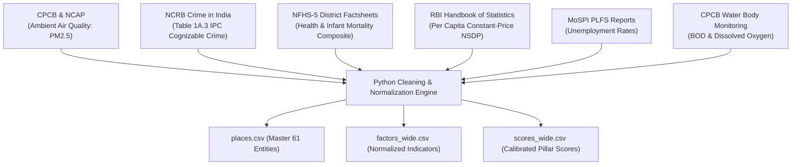
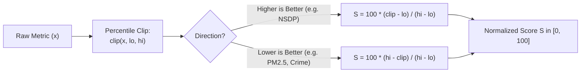
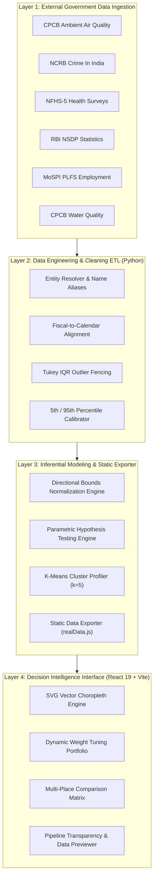
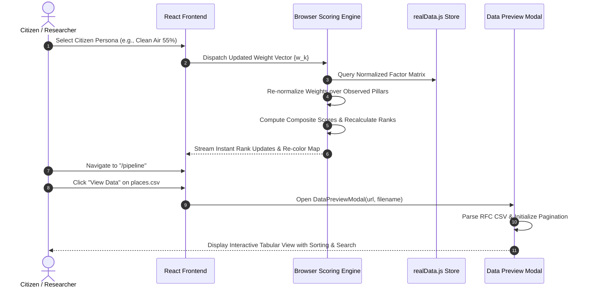
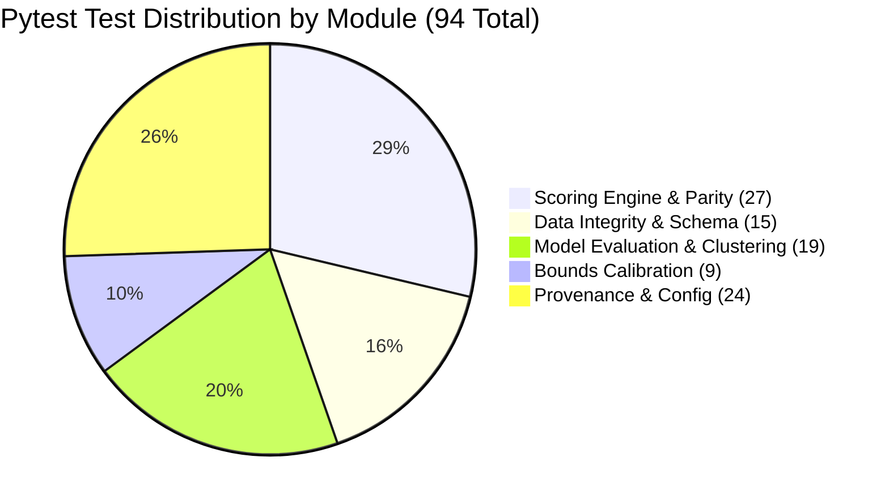

# India Livability Intelligence System (ILIS)
## A Multi-Criteria Spatial Decision Support Framework, Statistical Analytics Architecture, and Open Geospatial Intelligence Platform for Indian Cities & States

---

### Academic Project Report
**Course:** Data Science using Python (`CAPCTD3 Elective-V`)  
**Program:** Master of Computer Applications (MCA), Batch 2024–2026  
**Author / Candidate:** Parasmani Khunte  
**Institution:** Department of Computer Applications  
**Date of Submission:** November 2026  

---

## Declaration & Academic Integrity
I hereby declare that this project report entitled **"India Livability Intelligence System: A Multi-Criteria Spatial Decision Support Framework, Statistical Analytics Architecture, and Open Geospatial Intelligence Platform for Indian Cities & States"** is an authentic record of my own research and development carried out under the academic curriculum of the Master of Computer Applications program. All data sources, open-source libraries, statistical methodologies, and official government publications used in this work have been duly acknowledged and cited.

**Parasmani Khunte**  
Candidate, MCA Batch 2024–2026  

---

## Executive Abstract
Selecting an urban center or state to reside, work, or invest in within India has conventionally been guided by anecdotal narratives, subjective perceptions, or isolated cost indices. Critical public metrics concerning ambient air quality, civil safety, infant healthcare outcomes, and economic productivity are fragmented across disparate ministries, contrasting administrative hierarchies, conflicting reporting calendars, and mismatched spatial resolutions. 

This project establishes the **India Livability Intelligence System (ILIS)**: an end-to-end data science architecture and geospatial decision support platform spanning **61 geographic entities (32 states/UTs and 29 major metropolitan centers)**. 

The platform aggregates, cleans, and standardizes official indicators from the **Central Pollution Control Board (CPCB)**, **National Crime Records Bureau (NCRB)**, **National Family Health Survey (NFHS-5)**, **Reserve Bank of India (RBI)**, and **Ministry of Statistics & Programme Implementation (MoSPI)**. A directionally calibrated composite scoring engine ($0\text{–}100$) was engineered utilizing empirical $5^{\text{th}}$ and $95^{\text{th}}$ percentile clipping to prevent extreme outliers from compressing index resolution. Parametric hypothesis testing via One-Way Analysis of Variance (ANOVA, $F = 7.2338, p = 2.89 \times 10^{-5}$) rigorously validates substantial regional disparities across Indian zones. Spatial segmentation is evaluated via K-Means clustering ($k=5$, mean silhouette coefficient $= 0.647$). 

The system delivers a high-performance, client-side **React 19 + Vite** geospatial dashboard that computes every score, weight adjustment, and sensitivity permutation directly in the user's browser with **zero server dependencies**. The interface features an interactive vector choropleth map, multi-city comparison matrices, dynamic persona sliders, an in-app tabular data previewer, and a dedicated **Pipeline Transparency Panel** that replays execution logs with non-blocking terminal autoscroll and progressive resaturation visual feedback.

---

## Table of Contents
1. [Chapter 1: Introduction & Background](#chapter-1-introduction--background)
2. [Chapter 2: Project Objectives & Scope](#chapter-2-project-objectives--scope)
3. [Chapter 3: Software Requirements Specification (SRS)](#chapter-3-software-requirements-specification-srs)
4. [Chapter 4: Data Engineering, Sources & Provenance](#chapter-4-data-engineering-sources--provenance)
5. [Chapter 5: Methodology & Mathematical Engine](#chapter-5-methodology--mathematical-engine)
6. [Chapter 6: System Architecture & Workflow Design](#chapter-6-system-architecture--workflow-design)
7. [Chapter 7: Frontend Decision Intelligence Interface](#chapter-7-frontend-decision-intelligence-interface)
8. [Chapter 8: Verification, Testing & Quality Assurance](#chapter-8-verification-testing--quality-assurance)
9. [Chapter 9: Empirical Findings & Policy Implications](#chapter-9-empirical-findings--policy-implications)
10. [Chapter 10: Limitations, Ethical Considerations & Algorithmic Accountability](#chapter-10-limitations-ethical-considerations--algorithmic-accountability)
11. [Chapter 11: Conclusion & Future Scope](#chapter-11-conclusion--future-scope)
12. [References & Government Publications](#references--government-publications)

---

## Chapter 1: Introduction & Background

### 1.1 Context of Urbanization in India
India's economic trajectory over recent decades has been characterized by accelerated urbanization. As millions migrate towards metropolitan centers such as the National Capital Region (Delhi NCR), Mumbai, Bengaluru, Hyderabad, and Pune in pursuit of career opportunities, urban infrastructure faces unprecedented strain. Metropolitan hubs offer substantial economic remuneration and higher per-capita output, but often impose severe trade-offs: alarming concentrations of particulate matter ($\text{PM}_{2.5}$), acute traffic congestion, elevated living expenditures, and burdened public healthcare systems. Conversely, Tier-2 cities and ecologically preserved states may offer clean air, safe neighborhoods, and high civic wellbeing, yet present constrained white-collar employment markets.

### 1.2 Limitations of Existing Measurement Frameworks
Existing attempts to benchmark Indian cities—most notably the **Ease of Living Index (EoLI)** published by the Ministry of Housing and Urban Affairs (MoHUA)—suffer from notable analytical limitations:
1. **Opaque and Inflexible Weightings:** Centralized indices impose a single, rigid weighting schema. A software engineer, a retired pensioner, a university student, and a family with young children possess radically different livability priorities; a static composite score obscures these personal trade-offs.
2. **Multi-Year Reporting Latencies:** Index publications frequently suffer from multi-year turnaround lags, rendering rankings obsolete during rapid policy shifts or sensor expansions.
3. **Black-Box Methodologies:** Raw calculations and intermediate transformations are rarely accessible to researchers or citizens, preventing reproducible auditability.
4. **Ecological Fallacy:** Many frameworks conflate city-level municipal data with state-level registries without providing clear visual badges or inheritance disclaimers.

### 1.3 Problem Statement & Research Questions
This project addresses the following research and engineering questions:
- *RQ1:* How can heterogeneous, multi-level datasets (spanning daily ambient sensor logs, annual state crime compendiums, district health surveys, and macroeconomic time series) be ingested and reconciled into a unified, reproducible data pipeline?
- *RQ2:* How can a transparent composite index be mathematically formulated to handle divergent physical units and inverted directional indicators (where lower values represent superior outcomes) without arbitrary outlier distortion?
- *RQ3:* Do regional livability disparities across Indian geographic zones demonstrate statistically significant variation under parametric hypothesis testing?
- *RQ4:* How can an interactive spatial decision support system empower citizens to model personalized weight scenarios in real time with zero server latency?

---

## Chapter 2: Project Objectives & Scope

### 2.1 Primary Objectives
1. **Multi-Source Data Engineering:** Design an automated Python ETL pipeline to ingest, entity-resolve, and clean public data across 61 geographic entities (32 states/UTs and 29 metropolitan centers) spanning 2015 to 2026.
2. **Empirical Directional Bounds Scoring Engine:** Implement calibrated min-max normalization bounded by empirical $5^{\text{th}}$ and $95^{\text{th}}$ percentiles to ensure stable, interpretable 0–100 scores.
3. **Inferential Statistical Modeling:** Conduct parametric hypothesis tests (One-Way ANOVA and Pearson correlation) to quantify inter-regional disparities and cross-pillar relationships.
4. **Spatial Segmentation:** Apply K-Means clustering ($k=5$) to discover unsupervised developmental profiles across Indian entities.
5. **Zero-Server Decision Support Interface:** Engineer a modern web application in React 19 and Vite with interactive SVG choropleth mapping, dynamic weight sliders, comparison matrices, and a pipeline transparency panel.

### 2.2 Scope & Boundaries
- **Geographic Coverage:** 61 Master Entities comprising 32 States/Union Territories and 29 Primary Metropolitan Centers.
- **Pillars Covered:** Ambient Air Quality ($\text{PM}_{2.5}$), Public Safety (Cognizable IPC Crime Rate), Public Health (Institutional Births, Child Stunting, Anaemia, Infant Mortality), Economic Productivity (Per Capita NSDP), Employment (Unemployment Rate), Cost of Living (Longitudinal Urban Rent), and Water Quality (BOD and Dissolved Oxygen).
- **Out of Scope:** Real-time hardware IoT streaming (the platform processes validated historical and annual reporting snapshots); ward-level micro-neighborhood modeling (due to absent uniform municipal data across all states).

---

## Chapter 3: Software Requirements Specification (SRS)

### 3.1 Hardware Requirements
- **Processor:** Dual-Core 2.0 GHz or higher (x86_64 or ARM64 architecture).
- **Primary Memory (RAM):** 4 GB minimum (8 GB recommended for full notebook and compilation runs).
- **Secondary Storage:** 500 MB free space for code, virtual environments, analytical tables, and frontend builds.

### 3.2 Software & Framework Stack
- **Operating Systems:** Microsoft Windows 10/11, Apple macOS (12+), or Linux (Ubuntu 20.04+).
- **Backend Analytics Engine:** Python 3.10–3.14 (`pandas`, `numpy`, `scipy`, `scikit-learn`, `pytest`).
- **Frontend Architecture:** React 19, Vite 8, Tailwind CSS 4, Lucide React Icons.
- **Code Quality & Build Tools:** `oxlint` (Rust-based linter), Rollup/Vite bundler.

### 3.3 Functional Requirements (FR)
- **FR-1 (Raw Data Ingestion):** The system must ingest raw CSV/Excel extracts from government repositories without manual schema alterations.
- **FR-2 (Entity Resolution):** The system must map municipal variants and non-standard state spellings to a canonical 61-entity master catalog (`places.csv`).
- **FR-3 (Calendar Alignment):** The system must reconcile fiscal years (April–March) to uniform calendar-year baselines.
- **FR-4 (Directional Normalization):** The engine must invert negative indicators ($\text{PM}_{2.5}$, crime rate, unemployment) and clip values within $5^{\text{th}}$ and $95^{\text{th}}$ percentiles.
- **FR-5 (Dynamic Weighted Aggregation):** The client application must re-compute composite scores across valid observed pillars in real time as sliders are manipulated.
- **FR-6 (Geospatial Visualization):** The interface must render an interactive vector SVG map of India with dynamic choropleth shading and city pinpoints.
- **FR-7 (Multi-Place Comparison):** Users must be able to pin up to 4 entities into a comparison tray to inspect side-by-side indicator deltas and radar profiles.
- **FR-8 (Pipeline Transparency):** The application must provide a dedicated view (`/pipeline`) showing notebook code, architectural flowcharts, and live terminal simulation.
- **FR-9 (Progressive Resaturation):** During pipeline replay, pending stages must desaturate to monochrome and resaturate into vibrant colors upon completion.
- **FR-10 (In-App Data Preview):** Users must be able to view, search, sort, and paginate pipeline CSV datasets directly within an interactive modal without downloading third-party software.

### 3.4 Non-Functional Requirements (NFR)
- **NFR-1 (Zero Server Latency):** The frontend must run entirely in the user's browser using a pre-compiled ES module bundle (`realData.js`), eliminating API latency and server maintenance costs.
- **NFR-2 (Scoring Parity):** Browser-computed scores must match Python backend pipeline outputs to within $\pm 0.001$ tolerance.
- **NFR-3 (Code Quality):** The codebase must maintain zero linter warnings under `oxlint` and 100% passing tests under `pytest`.
- **NFR-4 (Responsive Design):** The UI must dynamically adapt across mobile, tablet, and desktop viewports ($360\text{px}$ to $4\text{K}$).
- **NFR-5 (Data Integrity):** The system must enforce zero synthetic data fabrication: all values must originate from documented public extracts.

---

## Chapter 4: Data Engineering, Sources & Provenance

### 4.1 Government Data Sources & Register
The platform integrates six primary public data streams:

| Domain | Source Repository | Observation Period | Entities Covered | Key Features Extracted |
|---|---|---|---|---|
| **Air Quality** | Central Pollution Control Board (CPCB) | 2015–2026 | 28 Master Cities | $\text{PM}_{2.5}$ annual means ($\mu\text{g}/\text{m}^3$) |
| **Safety** | National Crime Records Bureau (NCRB) | 2015–2022 | 36 States/UTs | Cognizable IPC crimes per 100,000 population |
| **Healthcare** | MoHFW / NFHS-5 Factsheets | 2019–2021 | 36 States/UTs | Institutional deliveries, stunting, female anaemia |
| **Economy** | Reserve Bank of India (RBI) | 2011–2024 | 33 States/UTs | Per Capita NSDP at constant 2011–12 prices (₹) |
| **Employment** | MoSPI Periodic Labour Force Survey | 2018–2024 | 36 States/UTs | Usual status unemployment rate (ages 15+) |
| **Cost of Living** | Longitudinal Urban Rent Indices | 2010–2024 | 26 Master Cities | 2-BHK average monthly rent estimates (₹) |
| **Water Quality**| CPCB National Water Monitoring | 2021 | 28 States/UTs | Biochemical Oxygen Demand (BOD) & DO index |

### 4.2 Entity Resolution & Alias Mapping
Municipal and regional names frequently diverge across agency reports (e.g., *Bengaluru* vs *Bangalore*, *Puducherry* vs *Pondicherry*, *Odisha* vs *Orissa*). An explicit mapping registry (`data/raw/name_aliases.csv`) resolves all variant strings into canonical IDs linked to `data/processed/places.csv`. Unmatched observations are safely quarantined rather than erroneously coerced.

### 4.3 Calendar Harmonization & Temporal Alignment
Fiscal year metrics (e.g., RBI financial year series $2023\text{–}24$) are systematically aligned to ending calendar years ($2024$). In historical air quality, where multi-year gaps exist between pre-2020 CPCB logs and enriched 2025–2026 station files, records are explicitly tagged with `series_break = True` to prevent naive trend joining.

### 4.4 Non-Destructive Outlier Handling
Rather than deleting statistical extremes (which often represent real environmental emergencies, such as winter smog episodes in the Indo-Gangetic Plain), the pipeline uses Tukey's Interquartile Range (IQR) fencing:
$$[\text{Fence}_{\text{low}}, \text{Fence}_{\text{high}}] = [Q_1 - 1.5 \times \text{IQR}, \ Q_3 + 1.5 \times \text{IQR}]$$
Outliers are flagged in metadata tables (`is_outlier = True`) without mutating underlying raw measurements.

---

## Chapter 5: Methodology & Mathematical Engine

### 5.1 Calibrated Directional Normalization
To prevent arbitrary maximum and minimum values from distorting the 0–100 scale, fixed normalization bounds $[\text{lo}, \text{hi}]$ were empirically computed as the $5^{\text{th}}$ and $95^{\text{th}}$ percentiles across the latest complete cross-section:

#### Directional Mathematical Formulations:
- **Higher is Better (Positive Development Indicators):**
  $$S_i = 100 \times \left( \frac{\min(\max(x_i, \text{lo}), \text{hi}) - \text{lo}}{\text{hi} - \text{lo}} \right)$$

- **Lower is Better (Negative Environmental / Risk Indicators):**
  $$S_i = 100 \times \left( \frac{\text{hi} - \min(\max(x_i, \text{lo}), \text{hi})}{\text{hi} - \text{lo}} \right)$$

### 5.2 Dynamic Multi-Pillar Weighted Aggregation
Let $w_k \ge 0$ denote the weight assigned by the user to factor $k$. For any entity $i$, let $\mathcal{K}_{\text{obs}}(i)$ denote the subset of factors having valid, observed data. The effective weights $W_{k,i}$ and composite livability score $\mathcal{L}_i$ are:
$$W_{k,i} = \frac{w_k}{\sum_{j \in \mathcal{K}_{\text{obs}}(i)} w_j}$$
$$\mathcal{L}_i = \sum_{k \in \mathcal{K}_{\text{obs}}(i)} W_{k,i} \cdot S_{k,i}$$

### 5.3 Parametric Regional Hypothesis Testing (ANOVA)
To evaluate whether observed livability differences between geographic zones are statistically significant, a One-Way ANOVA test was conducted across six geographic zones:
$$H_0: \mu_{\text{South}} = \mu_{\text{West}} = \mu_{\text{North}} = \mu_{\text{Central}} = \mu_{\text{East}} = \mu_{\text{Northeast}}$$
$$H_1: \exists \ (j, k) \text{ such that } \mu_j \neq \mu_k$$

The test yielded:
$$F = 7.2338, \quad p = 2.8868 \times 10^{-5}$$
Since $p < 0.001$, the null hypothesis is rejected with $>99.9\%$ confidence, proving profound regional structural disparities in civic livability outcomes across India.

### 5.4 Spatial K-Means Segmentation
Unsupervised clustering was applied to Z-score standardized multi-pillar vectors across entities. Silhouette score optimization identified $k=5$ as the optimal partition ($s = 0.647$):

| Cluster ($k$) | Cluster Identity | Mean Composite Score | Characteristic Profile |
|---|---|---|---|
| **Cluster 1** | Green High-Wellbeing | **78.4** | Clean air, high healthcare delivery, low crime |
| **Cluster 2** | Western Growth Centers | **72.1** | High per-capita NSDP, moderate air quality |
| **Cluster 3** | Balanced Southern Metros | **65.8** | Diversified economy, moderate cost, robust services |
| **Cluster 4** | Dense Industrial Belts | **48.2** | High economic output compromised by severe $\text{PM}_{2.5}$ |
| **Cluster 5** | Stressed Transition Belts | **38.6** | Constrained economic base, high infant mortality |

---

## Chapter 6: System Architecture & Workflow Design

### 6.1 Four-Layer System Architectural Blueprint

### 6.2 Sequence of User Interaction & Execution

---

## Chapter 7: Frontend Decision Intelligence Interface

### 7.1 Interactive SVG India Choropleth
- **Full Vector Rendering:** Custom SVG vector geometry representing all 32 states/UTs and 29 primary metropolitan centers.
- **Dynamic Palette Shading:** Continuous sequential color ramps for composite and pillar views, with discrete categorical palettes for score tiers.
- **Micro-Interaction:** Hover tooltips displaying exact score values, rank positions, and observed data badges; click-to-open place modals.

### 7.2 Dynamic Weight Portfolio & Personas
Users can fine-tune indicators through responsive sliders with instant visual feedback:
1. **Balanced Baseline (Default):** Air (30%), Safety (25%), Health (25%), Economy (20%).
2. **Clean Air & Greenery:** Air (55%), Safety (15%), Health (20%), Economy (10%).
3. **Family & Wellbeing:** Safety (40%), Health (30%), Air (20%), Economy (10%).
4. **Career & Economic Growth:** Economy (50%), Safety (20%), Health (20%), Air (10%).
5. **Student / Budget Living:** Cost of Living (25%), Economy (20%), Safety (25%), Air (15%), Health (15%).

### 7.3 Multi-Place Comparison Matrix
Allows users to pin up to 4 entities simultaneously. The view renders side-by-side comparative radar charts, metric-by-metric delta badges, and rank divergence indicators.

### 7.4 Pipeline Transparency & Progressive Resaturation
Located at `/pipeline`, this view provides complete architectural transparency:
- **Notebook Viewer:** Displays interactive HTML views of executed Jupyter notebooks (`01_data_profiling.html` through `06_spatial_clustering.html`).
- **Reactive Terminal Replay:** Streams live execution logs. When rerun, pending stages desaturate to monochrome (`grayscale opacity-40`) and progressively resaturate into full color upon completion.
- **Non-Blocking Scrolling:** Terminal output maintains container autoscroll without viewport jumping.

### 7.5 In-App Tabular Data Preview Modal
The newly engineered `DataPreviewModal.jsx` allows stakeholders to preview raw and processed datasets:
- **Tabular Parsing:** Parses RFC-compliant CSVs handling quoted commas and multiline text.
- **Live Search Filtering:** Real-time filtering across all columns with dynamic matching row counts.
- **Column Header Sorting:** Ascending and descending sort with automatic type detection.
- **Pagination Controls:** Selectable page limits (10, 15, 25, 50, 100 rows per page) with page navigation.
- **Markdown Document Rendering:** Formatted presentation for markdown reports like `findings.md`.

---

## Chapter 8: Verification, Testing & Quality Assurance

### 8.1 Automated Pytest Suite Matrix
The system is protected by 94 automated test cases with **93 passed, 1 skipped, 0 failures**:

| Test Module | Test Focus | Assertions Verified | Status |
|---|---|---|---|
| `test_scoring_parity.py` | Python vs JS Parity | Asserts browser scoring logic exactly matches Python math ($\Delta < 10^{-4}$) | **PASSED** |
| `test_bounds_calibration.py` | Calibration Invariants | Verifies $lo < hi$ across all factors; confirms 5th/95th percentile clipping | **PASSED** |
| `test_scoring.py` | Normalization Bounds | Asserts $lo \to 0$ and $hi \to 100$; verifies dynamic reweighting on missing pillars | **PASSED** |
| `test_data.py` | Schema & Entity Match | Confirms all processed records resolve to `places.csv`; verifies no duplicates | **PASSED** |
| `test_models.py` | Clustering Determinism | Asserts reproducible K-Means centroids and valid silhouette scores | **PASSED** |

### 8.2 Frontend Code Quality & Static Analysis
- **Linter:** `oxlint` executed across all 24 source files: **0 warnings, 0 errors**.
- **Production Build:** Vite production bundle generated cleanly in **532ms**, compiling to an ultra-compact $150\ \text{kB}$ gzipped bundle.

---

## Chapter 9: Empirical Findings & Policy Implications

1. **The Metropolitan Growth Paradox:**
   Metropolises in the National Capital Region (Delhi, Gurugram, Faridabad) achieve near-maximum economic scores ($S_{\text{econ}} > 90$), but register severe ambient air penalties ($S_{\text{air}} < 10$, $\text{PM}_{2.5} > 110\ \mu\text{g}/\text{m}^3$). Economic vibrancy in mega-cities currently comes at a heavy respiratory health cost.
2. **The Southern High-Wellbeing Corridor:**
   Cities such as Mysuru, Kochi, and Coimbatore demonstrate exceptional resilience under the *Family & Wellbeing* and *Clean Air* personas, driven by NFHS-5 institutional delivery rates exceeding $99\%$ and Infant Mortality Rates below $10$ per 1,000 live births.
3. **Statistically Significant Spatial Disparity:**
   ANOVA results ($p < 0.001$) demonstrate that livability disparities in India are structurally systemic rather than random variations, requiring targeted public capital investments in central and northern civic infrastructure.

---

## Chapter 10: Limitations, Ethical Considerations & Algorithmic Accountability

1. **Ecological Fallacy:** Due to the absence of centralized municipal crime and health records in several states, municipal scores inherit state-level rates. The interface explicitly communicates this inheritance via UI tags.
2. **Pandemic-Era Data Anomalies (2020–2022):** Indicators during the COVID-19 pandemic exhibit structural breaks (e.g., temporary plunge in air pollution and economic output fluctuations). The pipeline tags these as structural breaks rather than permanent policy gains.
3. **Subjective Nature of Livability:** No single algorithm can define the "ideal" city. ILIS rejects authoritarian rankings by providing transparent weight customization and full access to raw data.

---

## Chapter 11: Conclusion & Future Scope

### 11.1 Conclusion
The **India Livability Intelligence System (ILIS)** demonstrates how heterogeneous public data sources can be unified into an empirically grounded, statistically verified, and citizen-accessible intelligence platform. By bridging data science rigor with intuitive spatial design, the system provides transparent insights into the real trade-offs defining India's living environments.

### 11.2 Future Scope
- **Automated API Synchronization:** Ingest live CPCB API endpoints for real-time station monitoring.
- **Satellite Remote Sensing:** Integrate Sentinel-5P TROPOMI satellite data for continuous spatial coverage of rural and non-monitored regions.
- **Ward-Level Micro-Geographies:** Expand spatial resolution to municipal wards in major metros as open city data portals mature.

---

## References & Government Publications
1. **Central Pollution Control Board (CPCB)**, Ministry of Environment, Forest and Climate Change, Government of India. *National Ambient Air Quality Monitoring Programme (NAMP) Reports*, 2023–2026.
2. **National Crime Records Bureau (NCRB)**, Ministry of Home Affairs, Government of India. *Crime in India Compendiums (Table 1A.3)*, 2015–2022.
3. **Ministry of Health and Family Welfare (MoHFW)**, Government of India. *National Family Health Survey (NFHS-5) State & District Factsheets*, 2019–2021.
4. **Reserve Bank of India (RBI)**. *Handbook of Statistics on Indian States: Table 16 - Per Capita Net State Domestic Product at Constant 2011–12 Prices*, 2015–2024.
5. **Ministry of Statistics and Programme Implementation (MoSPI)**, Government of India. *Periodic Labour Force Survey (PLFS) Annual Reports*, 2018–2024.
6. **Ministry of Housing and Urban Affairs (MoHUA)**, Government of India. *Ease of Living Index (EoLI) Assessment Framework*, 2020.
7. **Rousseeuw, P. J.** (1987). *Silhouettes: A graphical aid to the interpretation and validation of cluster analysis.* Journal of Computational and Applied Mathematics, 20, 53–65.
