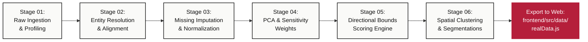

# India Livability Intelligence System (ILIS)
### A Multi-Criteria Spatial Decision Support System, Statistical Trend Architecture, and Open Geospatial Intelligence Platform for Indian Cities & States

[](https://www.python.org/)
[](https://react.dev/)
[](https://tailwindcss.com/)
[](tests/)
[](https://github.com/oxc-project/oxc)
[](#license--academic-disclaimer)
[](#author--academic-context)

---

## 📌 Executive Summary

Selecting a state or metropolitan center to live, work, or invest in within India has conventionally relied upon anecdotal narratives, uncurated perceptions, or isolated cost-of-living calculators. Public data concerning ambient air pollution, public safety, infant healthcare outcomes, and economic opportunities are fragmented across disparate ministries, contrasting administrative hierarchies, divergent calendar cycles, and varying spatial resolutions.

The **India Livability Intelligence System (ILIS)** resolves this fragmentation by establishing an end-to-end, reproducible data science architecture and geospatial decision support platform spanning **61 geographic entities (32 states/UTs and 29 major metropolitan centers)**. 

ILIS integrates official indicators from the **Central Pollution Control Board (CPCB)**, **National Crime Records Bureau (NCRB)**, **National Family Health Survey (NFHS-5)**, **Reserve Bank of India (RBI)**, and **Ministry of Statistics & Programme Implementation (MoSPI)**. The platform features an empirical directional-bounds scoring engine, parametric hypothesis testing (One-Way ANOVA, Pearson correlation), spatial K-Means clustering, and a high-performance **React + Vite** client-side dashboard that computes scores, sensitivity adjustments, and ranking models entirely in the user's browser with **zero server dependency**.

---

## 🎯 Project Objectives & Problem Statement

### The Problem
- **Metric Fragmentation:** Air quality (CPCB), crime rates (NCRB), health indicators (MoHFW/NFHS), and economic growth (RBI/MoSPI) are isolated across independent reports.
- **Opaque Weighting Schemes:** Existing government indices (such as MoHUA's Ease of Living Index) impose rigid, unmodifiable weight distributions that obscure critical citizen trade-offs.
- **Ecological Fallacy:** Many indices merge municipal metrics with state-level registries without transparently disclosing spatial resolution boundaries.
- **Data Latency:** Multi-year reporting lags prevent stakeholders from inspecting longitudinal trends and distributional sensitivity.

### Key Objectives
1. **Multi-Source Data Ingestion & Sanitization:** Clean, reconcile, and entity-resolve multi-level public datasets spanning city-level daily sensor observations and state-level socio-economic indicators.
2. **Directionally Calibrated Livability Index (0–100):** Formulate an empirical, mathematically sound composite scoring engine with percentile clipping ($5^{\text{th}}$ and $95^{\text{th}}$ percentiles) to prevent extreme outlier distortion.
3. **Parametric & Inferential Hypothesis Testing:** Evaluate spatial disparities across Indian geographic zones (South, West, North, Central, East, Northeast) using One-Way ANOVA and Pearson correlation.
4. **Spatial Segmentation & Offline Clustering:** Profile regional clusters using multi-dimensional K-Means segmentation ($k=5$, mean silhouette $= 0.647$) while preserving intuitive score bands for client-side decision-making.
5. **Interactive Geospatial Decision Intelligence:** Deliver a zero-latency, client-side web application featuring choropleth mapping, dynamic weight tuning, side-by-side place comparisons, and an end-to-end pipeline transparency monitor.

---

## 🏛️ System Architecture

The ILIS platform is engineered across four decoupled layers:

```mermaid
flowchart TD
    subgraph L1["1. Raw Ingestion Layer (Government Data Feeds)"]
        A1["CPCB / Ambient Air Quality\n(PM2.5 Daily Readings)"]
        A2["NCRB Crime in India\n(Cognizable IPC Rate / 100k)"]
        A3["NFHS-5 District Factsheets\n(Institutional Births, Stunting, Anaemia)"]
        A4["RBI Handbook of Statistics\n(Per Capita NSDP, Constant Prices)"]
        A5["MoSPI PLFS Reports\n(Unemployment Rates)"]
        A6["CPCB Water Quality\n(BOD & Dissolved Oxygen)"]
    end

    subgraph L2["2. Data Engineering & Cleaning Layer (Python ETL)"]
        B1["Entity Resolution\n(Master Places Catalog: 61 Entities)"]
        B2["Calendar Alignment\n(Fiscal-to-Calendar Harmonization)"]
        B3["Tukey IQR Outlier Fencing &\nSeries Break Classification"]
        B4["Bounds Calibration Engine\n(5th & 95th Percentile Clipping)"]
    end

    subgraph L3["3. Inferential Modeling & Analysis Layer"]
        C1["Directional Bounds Normalization\n(Higher=Better vs Lower=Better)"]
        C2["Parametric Hypothesis Testing\n(One-Way ANOVA & Pearson r)"]
        C3["Spatial K-Means Clustering\n(k=5, Silhouette Score = 0.647)"]
        C4["Static ES Module Exporter\n(realData.js Bundle Generator)"]
    end

    subgraph L4["4. Decision Intelligence Interface (React 19 + Vite)"]
        D1["Interactive SVG India Map\n(Choropleth & City Pins)"]
        D2["Dynamic Weight Portfolio\n(Live Sliders & 5 Personas)"]
        D3["Multi-City Comparison Matrix\n(Side-by-Side Radar & Delta)"]
        D4["Pipeline Transparency Panel\n(Terminal Runner, Flowchart, Data Preview)"]
    end

    L1 --> L2
    L2 --> L3
    L3 --> L4
```



---

## 🔄 End-to-End Pipeline Workflow

The automated data pipeline consists of 6 sequential, fully transparent stages:



1. **Stage 01 — Raw Ingestion & Profiling:** Ingests raw CSV and Excel extracts; performs schema validation, type enforcement, and null checks.
2. **Stage 02 — Entity Resolution & Alignment:** Resolves municipal and state naming aliases against `data/raw/name_aliases.csv`; harmonizes calendar-year timestamps.
3. **Stage 03 — Missing Imputation & Normalization:** Implements non-destructive Tukey IQR fencing, tags sensor transitions, and calculates state-level aggregates from city observations.
4. **Stage 04 — Weight Derivation & Sensitivity Analysis:** Derives baseline weights via Principal Component Analysis (PCA) and validates weight sensitivity via Monte Carlo perturbations.
5. **Stage 05 — Directional Bounds Scoring Engine:** Applies calibrated min-max inversion to convert raw physical metrics into standardized 0–100 scores.
6. **Stage 06 — Spatial Clustering & Multi-Criteria Segmentation:** Executes K-Means clustering ($k=5$) on standardized features and benchmarks clusters against national developmental baselines.

---

## 📐 Mathematical Formulation

### 1. Calibrated Directional Normalization
Raw indicators operate on disparate physical dimensions ($\mu\text{g}/\text{m}^3$, per 100,000 citizens, per 1,000 births, or Indian Rupees). Normalization bounds $[\text{lo}, \text{hi}]$ are fixed at empirical $5^{\text{th}}$ and $95^{\text{th}}$ percentiles to prevent extreme outliers from compressing the index:

- **Higher is Better (e.g., Per Capita NSDP, Health Composite):**
  $$S_i = 100 \times \frac{\text{clip}(x_i, \text{lo}, \text{hi}) - \text{lo}}{\text{hi} - \text{lo}}$$

- **Lower is Better (e.g., PM2.5, Cognizable Crime Rate, Unemployment):**
  $$S_i = 100 \times \frac{\text{hi} - \text{clip}(x_i, \text{lo}, \text{hi})}{\text{hi} - \text{lo}}$$

### 2. Dynamic Weighted Aggregation
Stakeholders can adjust factor weights $w_k \ge 0$ dynamically. The interface re-normalizes weights in real time:
$$W_k = \frac{w_k}{\sum_{j \in \mathcal{K}_{\text{obs}}} w_j}, \quad \text{Composite Score} = \sum_{k \in \mathcal{K}_{\text{obs}}} W_k \cdot S_k$$
*Where $\mathcal{K}_{\text{obs}}$ represents the subset of indicators with valid observations for the specific entity.*

### 3. Parametric Regional Hypothesis Testing (ANOVA)
To test if livability outcomes vary across Indian geographic regions:
$$H_0: \mu_{\text{South}} = \mu_{\text{West}} = \mu_{\text{North}} = \mu_{\text{Central}} = \mu_{\text{East}} = \mu_{\text{Northeast}}$$
$$F = \frac{\text{MS}_{\text{between}}}{\text{MS}_{\text{within}}} = 7.2338 \quad (p = 2.89 \times 10^{-5})$$
*With $p < 0.001$, the null hypothesis is rejected: substantial structural disparities exist between geographic zones.*

---

## 💻 Interactive Dashboard Capabilities

The frontend application (`India Livability Intelligence System/frontend`) is built with **React 19**, **Vite**, and **Tailwind CSS 4**:

- **Interactive SVG India Choropleth:** Pan, zoom, and drill down into all 32 states/UTs and 29 metropolitan pinpoints. Supports real-time switching between composite scores, individual pillars, and tier bands.
- **Dynamic Weight Portfolio:** Real-time client-side scoring with instant rank recalculation. Includes 5 pre-configured citizen personas:
  - ⚖️ *Balanced Baseline* (Air: 30%, Safety: 25%, Health: 25%, Economy: 20%)
  - 🌲 *Clean Air & Greenery* (Air: 55%, Safety: 15%, Health: 20%, Economy: 10%)
  - 👨‍👩‍👧 *Family & Wellbeing* (Safety: 40%, Health: 30%, Air: 20%, Economy: 10%)
  - 💼 *Career & Economic Growth* (Economy: 50%, Safety: 20%, Health: 20%, Air: 10%)
  - 🎓 *Student / Budget Living* (Cost: 25%, Economy: 20%, Safety: 25%, Air: 15%, Health: 15%)
- **Multi-Entity Comparison Tray:** Pin up to 4 states or cities side-by-side to inspect delta values, radar pillar profiles, and rank divergences.
- **Pipeline Transparency Panel (`/pipeline`):**
  - **Notebook View:** Complete step-by-step notebook runner with interactive cell outputs.
  - **Terminal View:** Real-time pipeline replay with non-blocking terminal autoscroll and progressive desaturation / resaturation animations.
  - **Architecture Flowchart:** 4-tier interactive visual swimlane diagram explaining data flow.
  - **In-App Data Previewer:** Integrated modal to inspect, search, sort, and paginate raw CSV artifacts (`places.csv`, `scores_wide.csv`, `factors_wide.csv`, `clusters.csv`) and Markdown reports (`findings.md`) directly in the browser.

---

## 📊 Data Provenance & Sources

| Indicator Pillar | Granularity | Primary Source | Timeframe | Attribution / Registry |
|---|---|---|---|---|
| **Air Quality (PM2.5)** | City (Station) | Central Pollution Control Board (CPCB) & NCAP | 2015–2026 | National Ambient Air Quality Monitoring |
| **Public Safety (Crime)** | State / UT | National Crime Records Bureau (NCRB) | 2015–2022 | *Crime in India* Table 1A.3 (IPC Rates) |
| **Public Health (Healthcare)** | State / UT | MoHFW / National Family Health Survey (NFHS-5) | 2019–2021 | District Factsheets (Institutional Births, Stunting, Anaemia) |
| **Economic Output (NSDP)** | State / UT | Reserve Bank of India (RBI) | 2011–2024 | Per Capita Net State Domestic Product (Constant Prices) |
| **Employment Health** | State / UT | MoSPI Periodic Labour Force Survey (PLFS) | 2018–2024 | Usual Status (Age 15+) Unemployment Rate |
| **Cost of Living (Rent)** | City | Longitudinal Urban Rent Indices | 2010–2024 | Modelled Municipal Housing Cost Estimates |
| **Water Quality** | State / UT | Central Pollution Control Board (CPCB) | 2021 | Water Body Monitoring (BOD & Dissolved Oxygen) |

---

## 🛠️ System Requirements

### Hardware Requirements
- **CPU:** Dual-core 2.0 GHz or higher (x86_64 or ARM64).
- **RAM:** 4 GB minimum (8 GB recommended for full pipeline and notebook execution).
- **Disk Space:** 500 MB free disk space for repository, dependencies, and datasets.

### Software Prerequisites
- **Operating System:** Windows 10/11, macOS 12+, or Ubuntu 20.04+ Linux.
- **Python:** Python 3.10, 3.11, 3.12, or 3.14.
- **Node.js & npm:** Node.js v20.19.0 or higher, npm v10.0.0 or higher.
- **Shell:** PowerShell 7+ (Windows) or Bash / Zsh (macOS / Linux).

---

## 🚀 Quick Start & Installation

### 1. Clone the Repository
```bash
git clone https://github.com/PARASMANI-KHUNTE/MCA_DSP_Project_2026.git
cd MCA_DSP_Project_2026
```

### 2. Backend Environment & Pipeline Setup
```bash
cd "India Livability Intelligence System"

# Create and activate virtual environment
python -m venv .venv

# Windows PowerShell:
.venv\Scripts\activate

# macOS / Linux:
# source .venv/bin/activate

# Install Python dependencies
pip install -r requirements.txt
```

### 3. Execute the Full Data Pipeline
```bash
# Clean, impute, and merge raw source tables
make data

# Calibrate percentile scoring bounds
python -m src.scoring.calibrate_bounds

# Execute directional scoring engine
python -m src.scoring.run_scoring

# Run ML clustering and model metrics
python -m src.models.run_ml

# Run exploratory statistical analysis and generate figures
python -m src.analysis.run_eda

# Export processed bundle to the frontend
python -m src.export_frontend_data
```

### 4. Start the Interactive Frontend Dashboard
```bash
cd frontend

# Install UI dependencies
npm install

# Start Vite development server
npm run dev
```
Open **[http://localhost:5173](http://localhost:5173)** in any modern web browser.

To create an optimized production build:
```bash
npm run build
npm run preview
```

---

## 🧪 Testing & Quality Assurance

The codebase enforces strict unit, schema, and integration testing:

```bash
cd "India Livability Intelligence System"

# Run the complete test suite (93 tests)
python -m pytest tests/ -v
```

### Test Coverage Highlights:
- **`test_bounds_calibration.py`:** Validates $5^{\text{th}}$ and $95^{\text{th}}$ percentile clipping bounds and ensures no zero-division conditions.
- **`test_data.py`:** Asserts schema compliance, coordinate bounds, master place references, and duplicate prevention.
- **`test_scoring.py`:** Confirms mathematical boundary invariants ($lo \to 0, hi \to 100$) and dynamic weight re-normalization.
- **`test_scoring_parity.py`:** Guarantees bit-level scoring parity between Python pipeline outputs and JavaScript client-side computations.
- **`test_model_evaluation.py`:** Verifies K-Means cluster determinism and silhouette score reproducibility.

### Frontend Linting:
```bash
cd frontend
npm run lint
```
*Validated with `oxlint`: **0 warnings, 0 errors** across all 24 source files.*

---

## 📁 Repository Structure

```text
MCA_DSP_Project_2026/
├── README.md                                 # Master repository documentation (this file)
└── India Livability Intelligence System/
    ├── README.md                             # Subsystem documentation & pipeline manual
    ├── Makefile                              # Make targets (make data, make test, make notebooks)
    ├── requirements.txt                      # Python dependencies
    ├── start.ps1                             # Automated PowerShell startup script
    ├── data/
    │   ├── raw/                              # Source register, aliases, and raw files (gitignored)
    │   └── processed/                        # Processed places, scores, factors, and clusters
    ├── frontend/                             # React 19 + Vite + Tailwind CSS dashboard
    │   ├── public/
    │   │   ├── data/                         # Public artifacts (places.csv, scores_wide.csv, etc.)
    │   │   └── pipeline/                     # Static HTML previews of stages 01-06
    │   └── src/
    │       ├── components/                   # UI components (Map, Sliders, Pipeline, Preview Modal)
    │       └── data/realData.js              # Exported analytical ES module bundle
    ├── notebooks/                            # Step-by-step Jupyter notebooks (Stages 01–06)
    ├── reports/                              # Capstone reports, findings, and audits
    │   ├── project_report.md                 # Complete formal academic project report
    │   ├── findings.md                       # Key empirical takeaways
    │   ├── bounds_calibration.md             # Percentile calibration documentation
    │   └── data_fabrication_audit.md         # Data integrity and provenance audit
    ├── src/                                  # Python source code
    │   ├── cleaning/                         # Pipeline ETL loaders and transformers
    │   ├── scoring/                          # Scoring engine, bounds calibration, factor config
    │   ├── models/                           # K-Means clustering and trend modeling
    │   ├── analysis/                         # Exploratory data analysis and ANOVA testing
    │   └── export_frontend_data.py           # Frontend bundle exporter
    └── tests/                                # Automated Pytest test suite (93 tests)
```

---

## 📈 Key Empirical Takeaways

1. **Environmental vs. Economic Trade-Off:** Metropolitan economic powerhouses (Delhi NCR, Mumbai, Bengaluru) achieve high economic scores (NSDP per capita $> \text{₹}250,000$), but suffer substantial penalties in ambient air quality ($\text{PM}_{2.5} > 85\ \mu\text{g}/\text{m}^3$).
2. **Regional Disparities:** One-Way ANOVA across Indian zones reveals statistically significant structural inequality ($F = 7.2338, p < 0.001$). Southern and Western states/cities consistently outscore Northern and Central belts across healthcare outcomes and civic safety.
3. **Subjective Livability:** Adjusting citizen persona weights dynamically shifts city rankings: a "Clean Air & Greenery" stakeholder ranks Mysuru, Chandigarh, and Panaji significantly higher than a "Career & Growth" stakeholder prioritizing gross economic output.

---

## ⚖️ Academic Context & Disclaimer

- **Course:** Data Science using Python (`CAPCTD3 Elective-V`)
- **Degree:** Master of Computer Applications (MCA), Batch 2024–2026
- **Author:** **Parasmani Khunte**
- **Data Provenance Notice:** This system is developed for academic evaluation. Indicators are derived from publicly accessible government publications and open statistical repositories. Regional estimates and state-inherited aggregates are transparently flagged as exploratory analytical approximations rather than certified regulatory standards.
